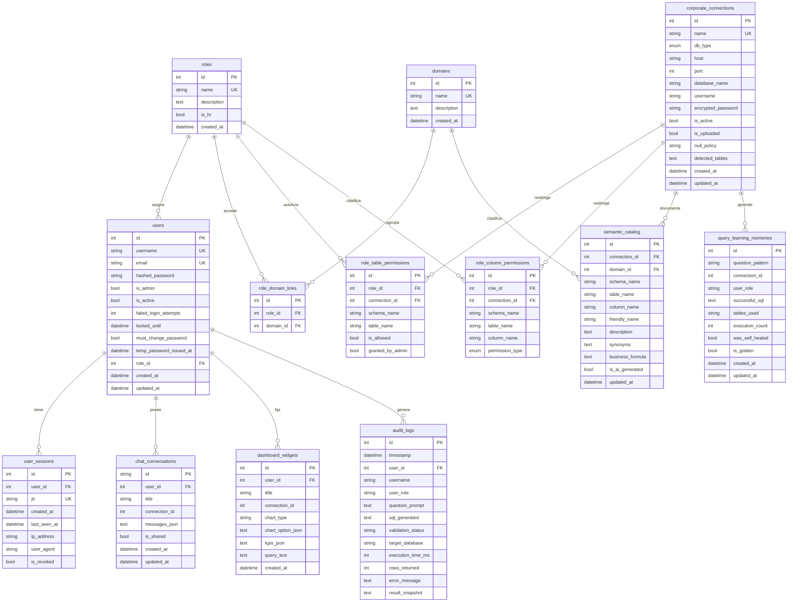
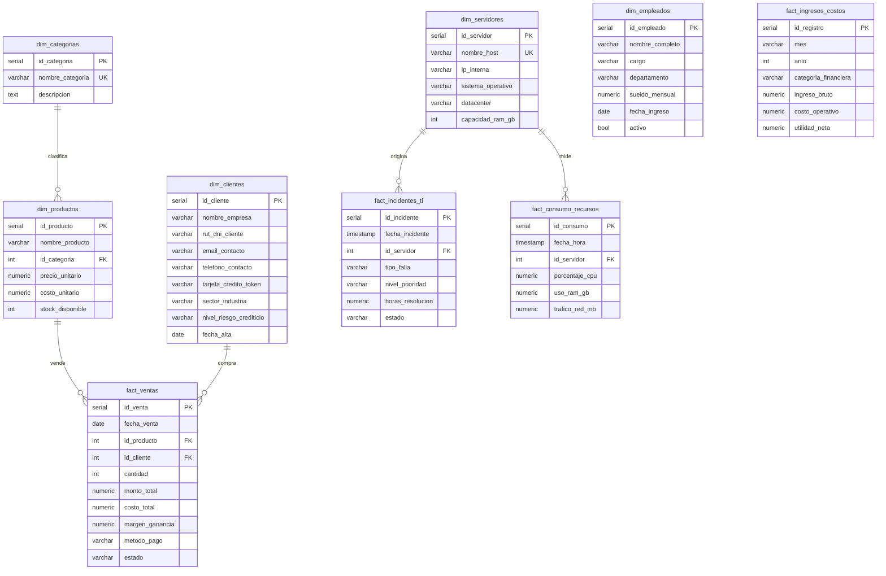

# Modelo de Datos

> **Documento:** 21 - Modelo de datos
> **Estado:** Vigente. Derivado de los modelos SQLAlchemy y del DDL de datos demo.
> **Última actualización:** 30 de octubre de 2026
> **Fuente:** `backend/app/modules/*/models.py`, `backend/scripts/setup_postgres_full.py`, `backend/app/core/database.py`

---

## 1. Dos bases, dos propósitos

Dat.ia usa **dos espacios de datos separados**:

| Espacio | Qué contiene | Quién lo escribe |
|---|---|---|
| **Metadata** (`democratizacion_metadatos`) | Usuarios, roles, permisos, catálogo, conexiones, conversaciones y auditoría | La plataforma |
| **Datos corporativos / demo** | Las tablas del cliente o el dataset de demostración | El cliente / el importador |

La separación es deliberada: el chat nunca escribe en la base corporativa. La metadata sí se escribe (login, sesiones, auditoría, widgets).

> El nombre de la base de metadata se configura con `POSTGRES_DB` (`config.py:91`). El seed de datos demo solo corre con `DEMO_MODE=true` (`test_demo_mode_gating.py`).

---

## 2. Diagrama entidad-relación — Metadata



> `chat_conversations.user_id` y `audit_logs.user_id` son nullable: una conversación o un log pueden sobrevivir al usuario (`ON DELETE SET NULL` / `CASCADE` según la tabla). Ver §5.

---

## 3. Diccionario de tablas de metadata

### 3.1 Seguridad y acceso

| Tabla | Propósito | Restricciones |
|---|---|---|
| `users` | Cuentas de la plataforma | `username` y `email` únicos; `role_id` → `roles.id` `ON DELETE SET NULL` |
| `roles` | Roles corporativos | `name` único; `is_hr` marca roles de talento humano |
| `domains` | Dominios de datos (Finanzas, RRHH, TI…) | `name` único |
| `user_sessions` | Sesiones JWT activas | `jti` único; `user_id` `ON DELETE CASCADE` |
| `role_domain_links` | Qué dominios ve cada rol | PK implícita por `id`; `role_id` y `domain_id` `ON DELETE CASCADE` |

**Campos de seguridad en `users`:**

- `failed_login_attempts` + `locked_until`: bloqueo tras 5 fallos durante 15 minutos.
- `must_change_password` + `temp_password_issued_at`: clave temporal de 7 días.
- `is_active`: un usuario desactivado no autentica.

### 3.2 Conexiones y catálogo

| Tabla | Propósito | Restricciones |
|---|---|---|
| `corporate_connections` | Conexiones a bases del cliente o datasets importados | `name` único; `encrypted_password` con Fernet; `is_uploaded` distingue dataset de base corporativa |
| `semantic_catalog` | Diccionario semántico por tabla/columna | `connection_id` `ON DELETE CASCADE`; `domain_id` `ON DELETE SET NULL` |
| `role_table_permissions` | Permiso de tabla por rol y conexión | `role_id` y `connection_id` `ON DELETE CASCADE`; `granted_by_admin` distingue default de concesión explícita |
| `role_column_permissions` | Clasificación `ALLOWED`/`MASKED`/`BLOCKED` | `role_id` y `connection_id` `ON DELETE CASCADE`; unicidad lógica por rol+conexión+tabla+columna |

**Índices de rendimiento** (creados por la auto-migración, `database.py:144-148`):

| Índice | Tabla | Columnas |
|---|---|---|
| `ix_role_table_perm_lookup` | `role_table_permissions` | `(role_id, connection_id, is_allowed)` |
| `ix_role_column_perm_lookup` | `role_column_permissions` | `(role_id, connection_id)` |
| `ix_semantic_catalog_connection` | `semantic_catalog` | `(connection_id)` |

> Los `Index(...)` declarados en el modelo solo existen en bases creadas desde cero. La auto-migración los agrega a instalaciones ya desplegadas con `CREATE INDEX IF NOT EXISTS` (`test_permission_indexes_migration.py`).

### 3.3 Conversación y aprendizaje

| Tabla | Propósito | Restricciones |
|---|---|---|
| `chat_conversations` | Hilos de conversación | `id` es un string de 64; `user_id` `ON DELETE CASCADE`; `messages_json` guarda el historial |
| `dashboard_widgets` | Widgets fijados por el usuario | `user_id` `ON DELETE CASCADE` |
| `query_learning_memories` | Consultas exitosas y golden queries | `question_pattern` indexado; `connection_id` sin FK física |

**Decisión:** `messages_json`, `chart_option_json`, `kpis_json` y `result_snapshot` son `Text` con JSON serializado. Se evita `JSONB` para no atar el modelo a PostgreSQL en tests y para mantener el snapshot como texto exportable tal como se generó.

### 3.4 Auditoría

| Tabla | Propósito |
|---|---|
| `audit_logs` | Registro de consultas, permisos, exportaciones y errores |

**Campos:**

| Campo | Tipo | Semántica |
|---|---|---|
| `timestamp` | DateTime indexado | Momento del evento (UTC naive) |
| `user_id` | FK nullable | `ON DELETE SET NULL`: el log sobrevive al usuario |
| `username` / `user_role` | String | Copia desnormalizada para conservar el contexto histórico |
| `question_prompt` | Text | Pregunta original |
| `sql_generated` | Text | SQL final ejecutado o rechazado |
| `validation_status` | String nullable | `APROBADO`, `APROBADO (Auto-Corregido)`, `RECHAZADO_RBAC`, `ERROR_EJECUCION` o `NULL` |
| `target_database` | String | Base contra la que se ejecutó (para reproducir) |
| `execution_time_ms` / `rows_returned` | Integer | Métricas de la ejecución |
| `error_message` | Text | Detalle del fallo |
| `result_snapshot` | Text | JSON con la respuesta exportable |

> **`validation_status = NULL` significa "sin registro", no "APROBADO".** La distinción está protegida por `test_validation_status_nullable_migration.py` y `test_audit_log_honesty.py`. Cualquier consulta que trate `NULL` como aprobación es un bug de seguridad.

---

## 4. Diagrama entidad-relación — Datos demo

El dataset de demostración es un estrella sencilla: 4 dimensiones y 5 hechos.



### 4.1 Tablas demo y su rol

| Tabla | Tipo | Rol de negocio | Datos sensibles de ejemplo |
|---|---|---|---|
| `dim_categorias` | Dimensión | Catálogo de categorías | — |
| `dim_productos` | Dimensión | Productos con precio y costo | Costo unitario (margen) |
| `dim_clientes` | Dimensión | Empresas clientes | `rut_dni_cliente`, `email_contacto`, `telefono_contacto`, `tarjeta_credito_token` |
| `dim_empleados` | Dimensión | Plantilla | `sueldo_mensual` |
| `dim_servidores` | Dimensión | Infraestructura | `ip_interna` |
| `fact_ventas` | Hecho | Ventas con margen | `margen_ganancia` |
| `fact_ingresos_costos` | Hecho | Ingresos, costos y utilidad | `utilidad_neta` |
| `fact_incidentes_ti` | Hecho | Incidentes y tiempos de resolución | — |
| `fact_consumo_recursos` | Hecho | CPU, RAM y red | — |

> Las columnas sensibles existen a propósito: son las que permiten demostrar `MASKED` y `BLOCKED` sin inventar un caso. En una instalación real, el cliente define sus propias columnas.

### 4.2 Restricciones del dataset demo

- `dim_productos.id_categoria` → `dim_categorias(id_categoria)`.
- `fact_ventas.id_producto` → `dim_productos(id_producto)`.
- `fact_ventas.id_cliente` → `dim_clientes(id_cliente)`.
- `fact_incidentes_ti.id_servidor` → `dim_servidores(id_servidor)`.
- `fact_consumo_recursos.id_servidor` → `dim_servidores(id_servidor)`.
- `fact_incidentes_ti.nivel_prioridad` tiene `CHECK` contra `BAJA`, `MEDIA`, `ALTA`, `CRITICA`.
- No hay `ON DELETE CASCADE` en el dataset demo: borrar una dimensión con hechos falla, que es el comportamiento correcto para un modelo analítico.

---

## 5. Reglas de integridad y cascadas

| Relación | Borrado | Justificación |
|---|---|---|
| `users.role_id` → `roles.id` | `SET NULL` | Borrar un rol no debe borrar usuarios |
| `user_sessions.user_id` → `users.id` | `CASCADE` | Sin usuario no hay sesión válida |
| `role_domain_links.role_id` / `domain_id` | `CASCADE` | El vínculo no tiene sentido sin sus extremos |
| `role_table_permissions.role_id` / `connection_id` | `CASCADE` | El permiso no tiene sentido sin rol o conexión |
| `role_column_permissions.role_id` / `connection_id` | `CASCADE` | Ídem |
| `semantic_catalog.connection_id` | `CASCADE` | El catálogo pertenece a la conexión |
| `semantic_catalog.domain_id` | `SET NULL` | Borrar un dominio no debe borrar la documentación |
| `chat_conversations.user_id` | `CASCADE` | El hilo es del usuario |
| `dashboard_widgets.user_id` | `CASCADE` | El widget es del usuario |
| `audit_logs.user_id` | `SET NULL` | La auditoría debe sobrevivir al borrado del usuario |

**Regla de negocio:** `audit_logs` no se borra en cascada desde ningún lado. Es el registro de cumplimiento.

---

## 6. Estados y enums

### `DatabaseType`

| Valor | Soporte |
|---|---|
| `postgresql` | Implementado |

El enum tiene **un solo valor** (`admin_catalog/models.py:7-8`). MySQL, SQL Server y Oracle no existen ni como valor: no hay driver ni rama de construcción de engine. Cualquier documento que los muestre como "soportados" contradice el código.

### `ColumnPermissionType`

| Valor | Efecto |
|---|---|
| `ALLOWED` | La columna se devuelve tal cual |
| `MASKED` | La columna se devuelve enmascarada |
| `BLOCKED` | La columna no se devuelve y el SQL no puede seleccionarla |

### `validation_status`

| Valor | Significado |
|---|---|
| `APROBADO` | El SQL pasó el validador y se ejecutó |
| `APROBADO (Auto-Corregido)` | El SQL falló, el LLM lo reparó y la reparación se validó |
| `RECHAZADO_RBAC` | El validador o el guard negaron la consulta |
| `ERROR_EJECUCION` | La base rechazó la consulta |
| `NULL` | **Sin registro**; no es aprobación |

---

## 7. Estrategia de migración

No se usa Alembic. La auto-migración vive en `backend/app/core/database.py`:

1. `Base.metadata.create_all()` crea tablas faltantes.
2. `ensure_schema_migrations()` agrega columnas nuevas con `ALTER TABLE ... ADD COLUMN IF NOT EXISTS`.
3. Crea índices faltantes con `CREATE INDEX IF NOT EXISTS`.
4. Usa `SET lock_timeout = '3s'` para no bloquear una instalación con sesiones abiertas.

**Ventajas:** instalación sin pasos manuales y sin dependencia de una herramienta extra.
**Límite:** no hay downgrade ni historial de versiones. Un cambio destructivo requiere un script manual y backup previo.

---

## 8. Volumen y retención

| Tabla | Crecimiento | Retención |
|---|---|---|
| `audit_logs` | Una fila por consulta, permiso y exportación | Sin purga automática (deuda declarada) |
| `user_sessions` | Una por login; se acumulan | Sin purga automática; se revocan por marca |
| `chat_conversations` | Una por hilo | Borrado manual por el usuario |
| `dashboard_widgets` | Por widget fijado | Borrado manual |
| `query_learning_memories` | Por consulta exitosa | Curaduría manual / borrado por endpoint |
| Metadata de catálogo | Por tabla y columna | Se actualiza, no crece sin control |

> **Deuda:** `audit_logs` puede crecer indefinidamente. La exportación tiene tope de 50.000 filas, pero la tabla no. Ver [`20_REQUISITOS_NO_FUNCIONALES.md`](20_REQUISITOS_NO_FUNCIONALES.md) §9.

---

## 9. Consultas de verificación

```sql
-- Tablas de metadata esperadas (13)
SELECT table_name
FROM information_schema.tables
WHERE table_schema = 'public'
ORDER BY table_name;

-- Un rol sin ninguna tabla asignada
SELECT r.name
FROM roles r
LEFT JOIN role_table_permissions p ON p.role_id = r.id AND p.is_allowed
WHERE p.id IS NULL;

-- Columnas bloqueadas de una conexión
SELECT table_name, column_name
FROM role_column_permissions
WHERE permission_type = 'BLOCKED'
ORDER BY table_name, column_name;

-- Logs sin estado de validación (no son aprobaciones)
SELECT COUNT(*) FROM audit_logs WHERE validation_status IS NULL;
```

---

## 10. Documentos relacionados

- [SRS](19_SRS.md)
- [Arquitectura técnica](02_ARQUITECTURA_TECNICA.md)
- [Diagramas UML](22_DIAGRAMAS_UML.md)
- [Manual técnico](23_MANUAL_TECNICO.md)
- [Pruebas](24_PRUEBAS.md)
