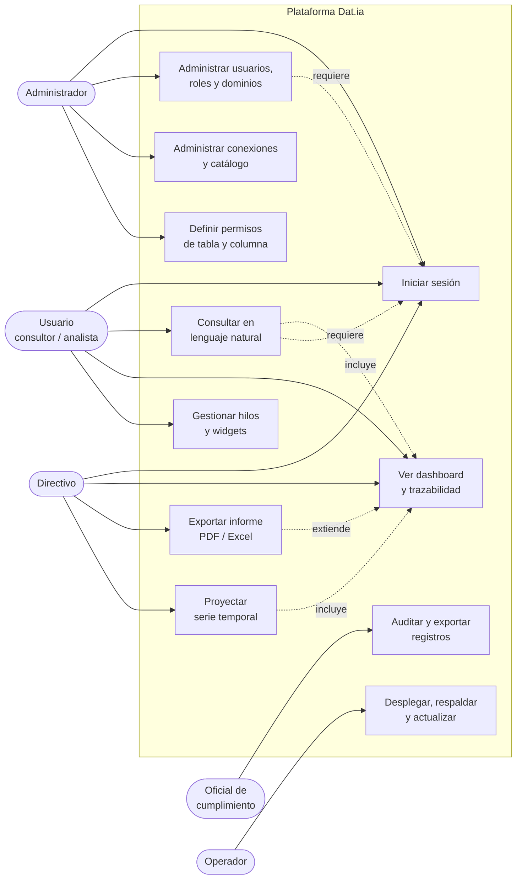
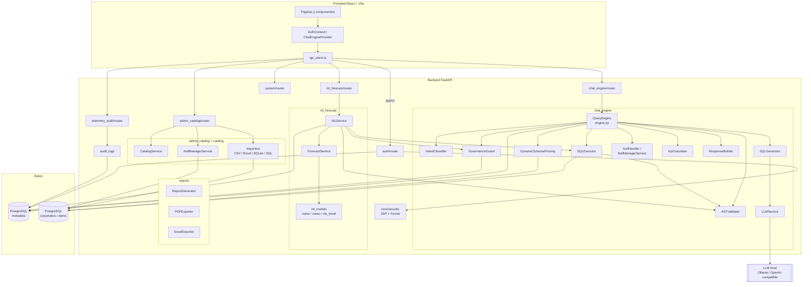
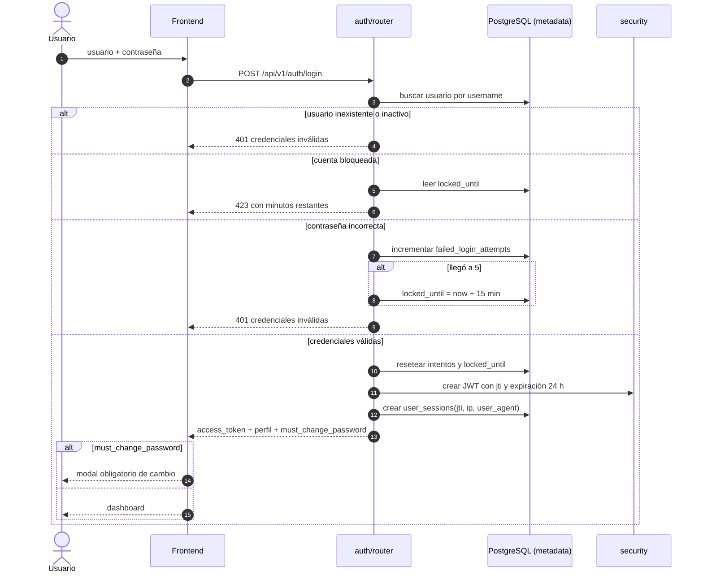
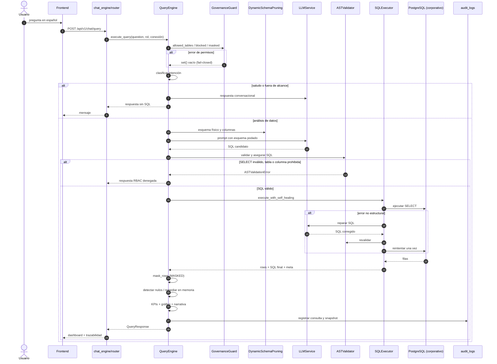
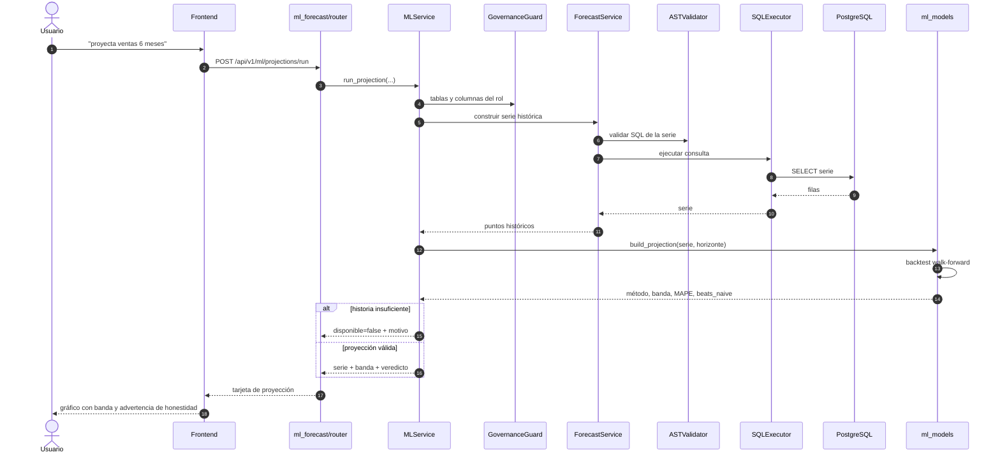
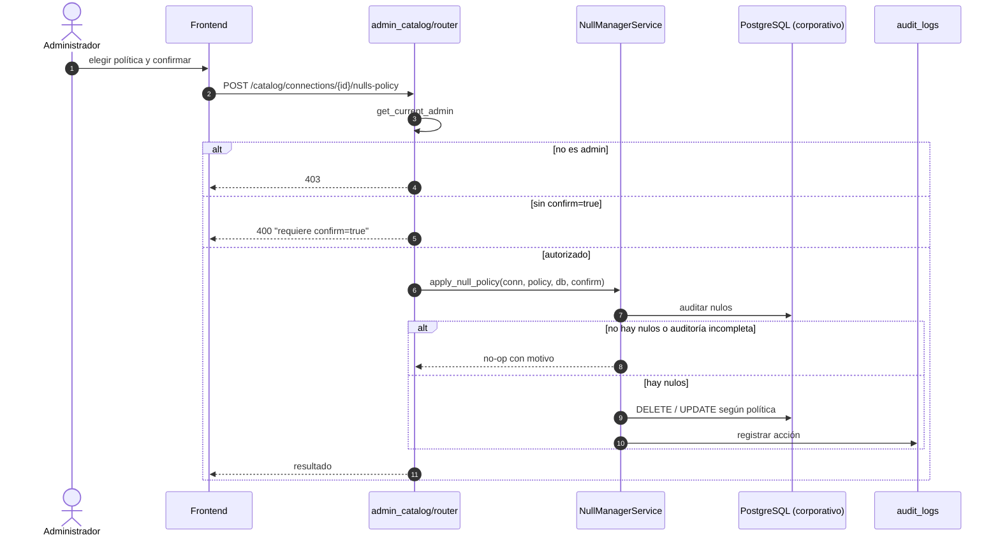
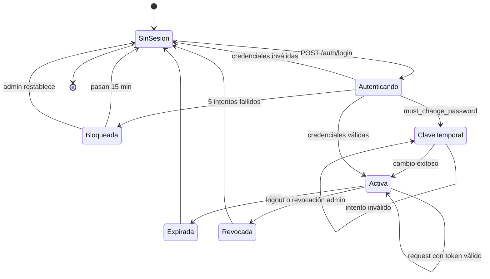
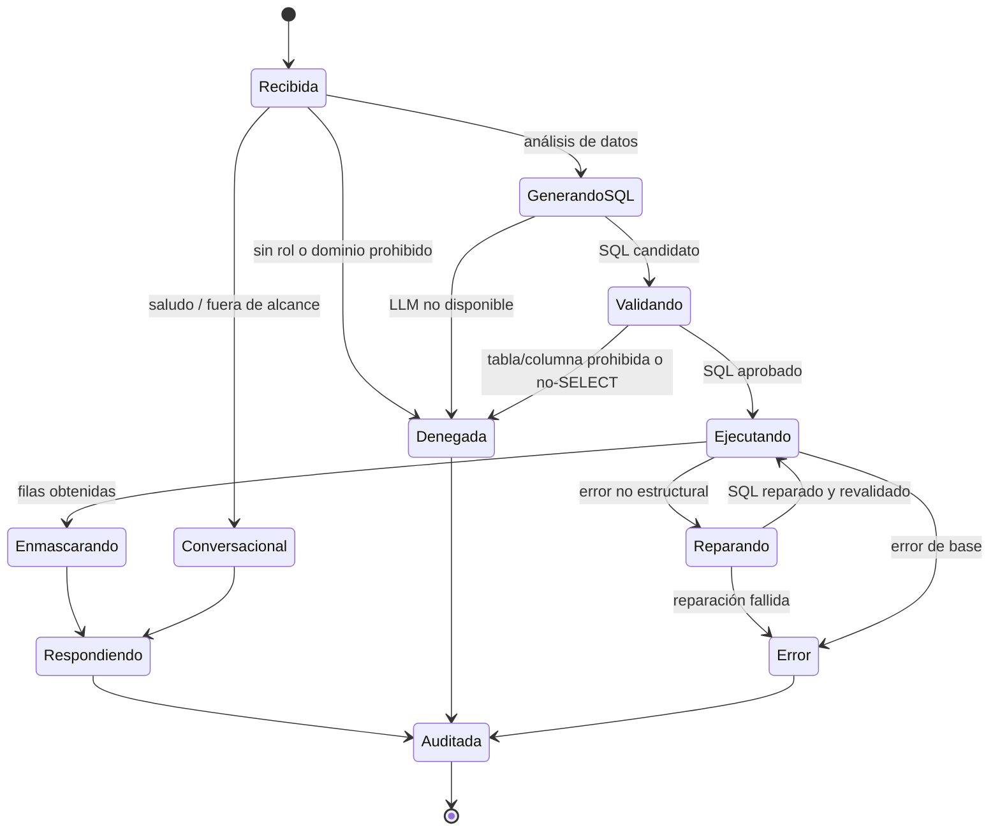
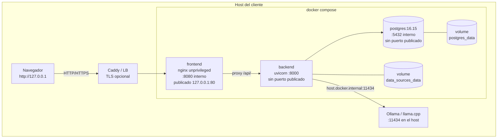

# Diagramas UML

> **Documento:** 22 - Diagramas UML y de despliegue
> **Estado:** Vigente. Diagramas generados desde el código, no desde un diseño previo.
> **Última actualización:** 30 de octubre de 2026
> **Herramienta:** Mermaid (renderiza en GitHub, GitLab y VS Code). Los PNG de `DOCS/imagenes/` son históricos y no se referencian.

---

## 1. Casos de uso

### Actores y alcance

| Actor | Casos que puede ejecutar |
|---|---|
| Usuario consultor | Login, consulta, dashboard, hilos, widgets |
| Analista / directivo | Además: proyecciones e informes |
| Administrador | Todo lo anterior + administración y permisos |
| Oficial de cumplimiento | Auditoría y exportación de logs |
| Operador | Fuera de la aplicación: despliegue y respaldo |

> El administrador **no** pasa por la matriz RBAC: `is_admin` devuelve todas las tablas y deja `blocked_columns` y `masked_columns` vacíos (`governance_guard.py:221-222,238-239,257-258`). Es una decisión de operación de la plataforma —quien administra conexiones necesita ver el esquema— y no un camino disponible para usuarios de negocio. Si se requiere que ni el admin vea una columna, hoy no está implementado.

---

## 2. Componentes

> El frontend nunca habla con el LLM ni con la base corporativa: solo con `/api/v1` a través de nginx. El backend es el único que ve credenciales y datos.

---

## 3. Clases del motor

```mermaid
classDiagram
    class QueryEngine {
        +execute_query(question, user_role, is_admin, db, role_id, connection_id, history, narrative_sink) QueryResponse
        +get_allowed_tables_for_role() Set~str~
        +get_blocked_columns_for_role() Set~str~
        +get_masked_columns_for_role() Set~str~
        +check_domain_governance() Optional~str~
        -_execute_conversational_branch(...) QueryResponse
        -_diagnose_empty_visibility(...) Tuple
        -_resolve_remediation_context(...) Tuple
    }

    class IntentClassifier {
        +classify_intent(question) str
        +detect_ambiguity_and_options(question, tables) List
        +generate_conversational_response(...) str
    }

    class SQLGenerator {
        +generate_candidate_sql(question, user_role, allowed_tables, db, ...) Tuple
    }

    class ASTValidator {
        +validate_and_secure_sql(sql, dialect, allowed_tables, blocked_columns, table_columns, is_admin) Tuple
        +extract_tables_from_query(sql, dialect) List~str~
        +generate_sql_explanation(sql, dialect) str
    }

    class SQLExecutor {
        +execute_raw_sql(target, sql, dialect) List~dict~
        +execute_with_self_healing(target, question, sql, allowed_tables, blocked_columns, table_columns_map, schema_context, is_llm_active, dialect, is_admin) Tuple
    }

    class GovernanceGuard {
        +get_allowed_tables_for_role(role, is_admin, db, role_id, connection_id) Set~str~
        +get_blocked_columns_for_role() Set~str~
        +get_masked_columns_for_role() Set~str~
    }

    class DynamicSchemaPruningService {
        +get_physical_db_tables(target) Set~str~
        +get_physical_table_columns(table, target, include_samples) List
        +prune_schema_for_question(...) str
    }

    class NullHandler {
        +inspect_nulls(rows) Tuple
        +build_null_alert_payload(rows, cols, count, table, question) Tuple
    }

    class NullManagerService {
        +audit_connection_nulls(conn) dict
        +apply_in_memory_remediation(rows, columns, action) List
        +apply_null_policy(conn, policy, db, confirm) dict
    }

    class KpiCalculator {
        +calculate_kpis(rows, columns, question) List
    }

    class ResponseBuilder {
        +build_analytics_response() QueryResponse
        +build_rbac_denied_response(question, reason) QueryResponse
        +build_execution_error_response(question, error, ms) QueryResponse
        +build_llm_offline_response(question, ms) QueryResponse
    }

    class LLMService {
        +generate_completion(prompt, system_prompt, temperature, max_tokens, base_url, model_name) str
        +stream_completion() AsyncIterator
        +resolve_model_for(base_url, model) str
    }

    class MLService {
        +projection_context(...) dict
        +analyze_question(...) dict
        +run_projection(...) dict
    }

    class ForecastService {
        +build_series(...) dict
    }

    class ml_models {
        +METHODS
        +build_projection(series, horizon, method) dict
    }

    class ReportGenerator {
        +generate_pdf(req) bytes
        +generate_excel(req) bytes
        -_prepare_export(db, user, req, include_chart_image) Tuple
    }

    QueryEngine --> IntentClassifier
    QueryEngine --> SQLGenerator
    QueryEngine --> ASTValidator
    QueryEngine --> SQLExecutor
    QueryEngine --> GovernanceGuard
    QueryEngine --> DynamicSchemaPruningService
    QueryEngine --> NullHandler
    QueryEngine --> NullManagerService
    QueryEngine --> KpiCalculator
    QueryEngine --> ResponseBuilder
    SQLGenerator --> LLMService
    SQLExecutor --> ASTValidator
    SQLExecutor --> LLMService
    MLService --> ForecastService
    ForecastService --> ml_models
    MLService --> ASTValidator
    MLService --> SQLExecutor
    MLService --> GovernanceGuard
    ReportGenerator --> PDFExporter
    ReportGenerator --> ExcelExporter
```

---

## 4. Secuencia — Inicio de sesión

---

## 5. Secuencia — Consulta en lenguaje natural

> El orden importa: el enmascarado ocurre **antes** de que las filas alimenten KPIs, narrativa, snapshot de auditoría o exportación. Si se invierte, el dato sensible se filtra por un camino lateral.

---

## 6. Secuencia — Proyección ML

---

## 7. Secuencia — Política de nulos (escritura física)

> Este es el **único** camino que escribe en la base del cliente. El chat remedia en memoria (`apply_in_memory_remediation`) y nunca ejecuta `DELETE`/`UPDATE`.

---

## 8. Estados — Sesión

---

## 9. Estados — Consulta

---

## 10. Despliegue

### Puertos reales

| Servicio | Puerto interno | Publicado (dev) | Publicado (partner) | Motivo |
|---|---|---|---|---|
| frontend | 8080 | `127.0.0.1:80` y `127.0.0.1:5173` | `127.0.0.1:80` y `127.0.0.1:5173` | Único punto de entrada; solo loopback |
| backend | 8000 | **ninguno** | `127.0.0.1:8000` | En dev se evita saltar nginx; en partner queda para depuración local |
| postgres | 5432 | **ninguno** | **ninguno** | La base no se expone al host |

> En Docker Desktop/Windows, publicar en `0.0.0.0` expone la app a la LAN. Ambos compose publican solo en loopback; para acceso desde otras máquinas se usa Caddy/LB con TLS (`deploy/README.md`). El partner compose permite cambiar la IP con `DATIA_BIND_IP`, que es una decisión explícita.

---

## 11. Notas de mantenimiento

- Los diagramas se escriben en Mermaid dentro del Markdown: no hay binarios que regenerar.
- Si cambia el pipeline del motor, se actualiza §5; si cambia el compose, §10.
- Los diagramas de `DOCS/imagenes/` están desactualizados (muestran puertos y fallback que ya no existen) y no deben citarse.
- Los diagramas no reemplazan al código: si hay contradicción, gana el código y el diagrama se corrige.

---

## 12. Documentos relacionados

- [Arquitectura técnica](02_ARQUITECTURA_TECNICA.md)
- [Modelo de datos](21_MODELO_DE_DATOS.md)
- [SRS](19_SRS.md)
- [Manual técnico](23_MANUAL_TECNICO.md)
- [Docker](26_DOCKER.md)
