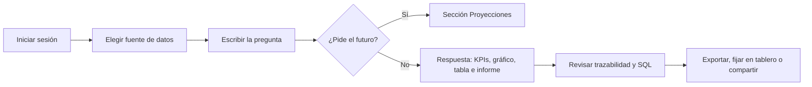

# Manual de Usuario

> **Documento:** 27 - Manual de usuario
> **Estado:** Vigente. Describe la interfaz y los flujos implementados.
> **Última actualización:** 06 de noviembre de 2026
> **Audiencia:** usuarios finales, administradores de plataforma y soporte de primer nivel
> **Producto:** Dat.ia 1.0.0 — analítica conversacional con IA local

---

## Contenido

| Sección | Tema |
|---:|---|
| 1 | Qué es Dat.ia y qué puede hacer |
| 2 | Antes de empezar: acceso, perfiles y permisos |
| 3 | Primer ingreso y cambio de contraseña |
| 4 | La pantalla principal y los atajos |
| 5 | Consultar datos: pregunta, respuesta, gráficos, tabla, informe y trazabilidad |
| 6 | Historial de conversaciones |
| 7 | Tablero ejecutivo |
| 8 | Alertas y anomalías |
| 9 | Modo presentación |
| 10 | Proyecciones con machine learning |
| 11 | Opciones y diagnóstico |
| 12 | Administración: fuentes, usuarios, permisos, catálogo y auditoría |
| 13 | Mensajes frecuentes y solución de problemas |
| 14 | Buenas prácticas |
| 15 | Límites y alcance |
| 16 | Glosario |
| 17 | Base de este manual y mantenimiento |

---

## 1. Qué es Dat.ia y qué puede hacer

Dat.ia es una plataforma de analítica conversacional que permite consultar una base de datos corporativa en lenguaje natural. El sistema traduce la pregunta a SQL, valida que la consulta sea de solo lectura y la ejecuta respetando el perfil de acceso de cada usuario.

Con Dat.ia usted puede:

- Preguntar por ventas, márgenes, clientes, personal, servidores, incidentes o encuestas sin escribir SQL.
- Recibir la respuesta como KPIs, gráfico, tabla de datos e informe ejecutivo.
- Revisar el SQL ejecutado y el detalle de auditoría de cada consulta.
- Exportar la respuesta a PDF, Excel o CSV.
- Fijar gráficos y KPIs en un tablero ejecutivo.
- Proyectar series temporales con evidencia de error y backtest.
- Compartir una conversación con otro usuario autorizado.

Lo que **no** hace:

- No modifica los datos de la base corporativa desde el chat. Las consultas del chat son de solo lectura.
- No envía datos a la nube: el modelo de lenguaje es local.
- No se conecta a MySQL ni a SQL Server. El motor soportado es PostgreSQL.
- No permite autorregistro ni autoservicio de contraseña: las cuentas y los resets los gestiona un administrador.

> **Alcance de este manual.** Describe la interfaz visible. No reemplaza al [Manual Técnico](23_MANUAL_TECNICO.md) ni a la guía de [Docker](26_DOCKER.md). Si una etiqueta de la interfaz cambia, la interfaz actual es la que manda.

### 1.1 Recorrido básico

---

## 2. Antes de empezar

### 2.1 Acceso

Abra en su navegador la dirección que le entregue el administrador. En una instalación on-prem habitual es `http://127.0.0.1:8080`; en desarrollo puede ser `http://localhost:5173`.

No necesita instalar nada en su equipo. Use un navegador actualizado (Chrome, Edge, Firefox o Safari recientes) y asegúrese de tener acceso de red al servidor de Dat.ia.

### 2.2 Perfiles y permisos

Los permisos se otorgan por **responsabilidad funcional**, no por jerarquía personal. El perfil determina qué tablas y columnas puede consultar. La matriz es configurable por un administrador; la siguiente tabla describe el alcance **sembrado por defecto** en la demostración.

| Perfil | Para qué sirve | Alcance por defecto |
|---|---|---|
| **Administrador de Plataforma** | Gobierna la plataforma | Todo: usuarios, roles, conexiones, catálogo, permisos y auditoría. Es el único perfil que ve las columnas sensibles en claro. |
| **Director Ejecutivo (C-Level)** | Visión consolidada y riesgo | Rentabilidad consolidada (`fact_ingresos_costos`), catálogo, personal con columnas salariales restringidas y encuestas. No ve el detalle transaccional ni infraestructura. |
| **Analista Financiero & Comercial** | Ventas, facturación y márgenes | Bloque transaccional (`fact_ventas`, `dim_clientes`, `fact_ingresos_costos`), catálogo, personal sin remuneraciones y encuestas. No ve infraestructura. |
| **Gerente de Talento & Operaciones** | Plantilla, clima y encuestas | Personal (incluye remuneraciones) y encuestas. No ve negocio ni infraestructura. |
| **Analista de Datos & BI** | Exploración técnica y operativa | Infraestructura, personal sin remuneraciones y encuestas. No ve finanzas ni catálogo comercial. |
| **Ingeniero de Infraestructura & TI** | Servidores, consumo e incidentes | Infraestructura, personal sin remuneraciones y encuestas. No ve finanzas ni catálogo comercial. |
| **Oficial de Cumplimiento & Seguridad** | Trazabilidad y auditoría | Infraestructura, catálogo, personal sin remuneraciones y encuestas. No ve ventas ni márgenes. |
| **Usuario Consultor** | Lectura mínima | Catálogo de productos y encuestas. No ve personal, negocio ni infraestructura. |

> **La matriz puede cambiar.** Un administrador puede conceder o revocar tablas y clasificar columnas. Si una consulta le responde «Acceso denegado» o «Bloqueada por gobernanza», pida la revisión del permiso; no es un error de la IA.

### 2.3 Qué necesita saber para preguntar

Cuanto más concreta sea la pregunta, mejor será la respuesta. Procure indicar:

- **Métrica**: qué quiere medir (ventas, margen, cantidad, promedio, costo).
- **Dimensión**: cómo quiere agrupar (mes, categoría, cliente, sucursal).
- **Período**: rango de fechas o año.
- **Filtro**: condición adicional (solo una categoría, solo clientes activos).

Ejemplo: «Muestra las ventas totales por mes durante 2026 para la categoría Software».

---

## 3. Primer ingreso

### 3.1 Iniciar sesión

1. Abra la URL de Dat.ia.
2. Escriba su **Usuario Corporativo** y su **Contraseña**.
3. Puede usar el icono del ojo para mostrar u ocultar la contraseña.
4. Pulse **Ingresar**.

Si las credenciales son incorrectas, verá un mensaje de error. Después de **5 intentos fallidos**, la cuenta se bloquea durante **15 minutos**. Espere ese plazo o pida al administrador que restablezca el acceso.

En instalaciones de demostración aparece el selector **«O entrá con un perfil de la demo»**. Al elegir un perfil se rellenan el usuario y la contraseña, pero **no se inicia sesión automáticamente**: debe pulsar **Ingresar**. En una instalación de cliente este selector no se muestra.

### 3.2 Contraseña temporal y cambio obligatorio

Cuando un administrador crea su cuenta o restablece su clave, recibe una **contraseña temporal** que solo se muestra una vez. Al entrar con ella, el sistema lo lleva a la pantalla **«Cambio de contraseña obligatorio»** antes de permitirle operar.

Para definir su nueva contraseña:

1. Escriba la contraseña actual o temporal.
2. Escriba la nueva contraseña. Debe tener **al menos 12 caracteres** y ser distinta de la anterior.
3. Repita la nueva contraseña.
4. Revise el medidor de fortaleza. El mínimo de 12 caracteres es obligatorio; mayúsculas, números y símbolos mejoran la fortaleza, pero no son obligatorios.
5. Pulse **Cambiar contraseña**.

Al cambiar la contraseña se invalidan las demás sesiones; la sesión actual se conserva. Si no puede completar el cambio, use **Salir de mi cuenta**.

Si su cuenta conserva una contraseña temporal con plazo, verá un aviso con los días restantes y el botón **Cambiar ahora**. Si la temporal vence, el sistema lo obliga a cambiarla en el siguiente acceso.

### 3.3 Si no puede entrar

- **«Credenciales inválidas»**: revise usuario y contraseña. Si persiste, pida un reset al administrador.
- **Cuenta bloqueada**: espere 15 minutos desde el último intento fallido.
- **Contraseña temporal vencida**: el administrador debe generar una nueva.
- **«Sin rol asignado»**: su cuenta existe pero no tiene perfil. Pida a un administrador que le asigne uno; sin rol no podrá consultar datos.
- **No hay autoservicio de contraseña**: el enlace o formulario de recuperación no existe. El reset lo hace un administrador desde **Gobernanza RBAC → Usuarios & Roles RBAC**.

---

## 4. La pantalla principal

### 4.1 Encabezado

El encabezado superior contiene:

- **Logo y nombre DATIA**: vuelve al chat.
- **Estado del sistema** (en escritorio): insignia con el estado de la IA local y la base de metadatos. Al pulsarla se abre un panel con el detalle del motor LLM, la base de metadatos y las fuentes corporativas activas. El botón **Actualizar Estado** vuelve a consultar.
- **Navegación**: **Dashboard & Chat**, **Opciones**, **Proyecciones** y, solo para administradores, **Gobernanza RBAC**. En pantallas pequeñas la navegación está en el menú hamburguesa.
- **Tema**: alterna entre modo claro y oscuro. La preferencia se recuerda en este navegador.
- **Usuario y rol**: muestra su nombre y el perfil activo.
- **Cerrar Sesión Segura**: cierra la sesión.

Estados posibles de la insignia:

| Estado | Significado |
|---|---|
| **IA Local Activa** | El motor LLM responde. |
| **Sistema Degradado** | Algún componente no responde, pero el sistema puede seguir operando. |
| **LLM No Disponible** | El motor de lenguaje no responde. El chat puede rechazar consultas. |
| **Estado del Sistema Desconocido** | No se pudo consultar el estado. No significa necesariamente que esté caído. |

### 4.2 Barra lateral de conversaciones

La barra lateral izquierda contiene:

- **Nueva consulta** (`Ctrl+N`): abre una conversación nueva. No cancela una consulta que ya esté corriendo; su respuesta queda en la conversación original.
- **Buscar conversación** (`Ctrl+K`): filtra el historial por título.
- **Historial de consultas**: agrupado en **Hoy**, **Ayer** y **Anteriores**.
- **Eliminar conversación**: el icono de papelera aparece al pasar el cursor. La eliminación es definitiva desde la interfaz.
- **Fuente BD activa**: muestra la fuente que se usará en las consultas.

En pantallas pequeñas, el botón de historial abre la barra lateral como panel deslizante.

### 4.3 Zona de conversación

En la parte superior de la conversación encontrará:

- **Selector de fuente de datos**, si hay más de una fuente registrada.
- **Alertas**: insignia con el número de anomalías detectadas. Solo aparece si hay alguna o si no se pudo consultar el estado (en ese caso muestra **DESCONOCIDO**).
- **Tablero (n)**: abre el tablero ejecutivo con los widgets fijados.
- **Proyecciones**: abre la sección de proyecciones con machine learning.
- **Presentar**: activa el modo presentación (`F11`).

Si la conversación está vacía, verá una pantalla de bienvenida con sugerencias de consulta. Al hacer clic en una sugerencia se envía la pregunta.

### 4.4 Atajos de teclado

| Atajo | Acción |
|---|---|
| `Enter` | Enviar la pregunta (en el chat y en Proyecciones). |
| `Shift+Enter` | Insertar un salto de línea sin enviar. |
| `Ctrl+N` | Nueva consulta (solo en el chat). |
| `Ctrl+K` | Buscar en el historial (solo en el chat). |
| `F11` | Entrar o salir del modo presentación. |
| `Esc` | Salir del modo presentación o cerrar un diálogo. |

---

## 5. Consultar datos

### 5.1 Escribir una pregunta

1. Verifique la **fuente de datos activa** en la barra superior o en el pie de la barra lateral.
2. Escriba la pregunta en el cuadro inferior.
3. Pulse **Enter** o el botón de enviar.

La pregunta se envía al motor local. Mientras se procesa, verá su mensaje y una burbuja de Dat.ia con el texto **«Procesando con IA Local»** y un contador de segundos.

Si la consulta tarda más de 8 segundos, aparece un aviso que explica que el motor local puede tardar entre 8 y 25 segundos porque encadena varias llamadas al modelo. No está colgado.

El navegador corta la espera a los **90 segundos**. Si eso ocurre, la pregunta queda en pantalla con el motivo y el botón **Reintentar**. El servidor pudo haber seguido trabajando; el corte solo abandona la espera del navegador.

### 5.2 Smart Builder

El botón **Smart Builder** abre un asistente guiado en tres pasos:

1. **Métrica**: ventas, margen de utilidad, costos operativos, incidentes de TI o consumo de CPU y memoria.
2. **Agrupación**: por mes, por categoría, por sucursal/datacenter o por cliente.
3. **Período**: este año, últimos 90 días o todo el histórico.

Puede usar **Insertar texto** para cargar la pregunta en el editor y modificarla, o **Consultar Ahora** para enviarla directamente. Las opciones son ejemplos de arranque; puede escribir cualquier pregunta en el cuadro normal.

### 5.3 Elegir la fuente de datos

Si hay más de una fuente registrada, use el selector **Seleccionar Fuente de Datos Activa** en la barra superior. Al cambiar de fuente, el chat actualiza las sugerencias y las consultas siguientes usan esa fuente.

La fuente activa también aparece en el pie de la barra lateral y en la insignia del cuadro de pregunta. Si no hay ninguna fuente activa, el sistema muestra un diagnóstico; un administrador puede activarla desde **Gobernanza RBAC → Fuentes BD Corporativas**.

### 5.4 Mientras la IA trabaja

- El contador de segundos es real; no es una barra de progreso inventada.
- A los 8 segundos aparece el aviso de espera larga.
- Puede pulsar **Cancelar** para dejar de esperar. La petición ya pudo llegar al servidor y el motor local puede seguir trabajando; el resultado se descarta y no se agrega una respuesta a la conversación.
- Si la consulta falla o se cancela, la pregunta queda en pantalla con **Reintentar**.
- Si abre una **Nueva consulta** mientras una sigue en curso, la respuesta queda en **su** conversación original y se le avisa dónde quedó. El campo de pregunta se habilita cuando la consulta termina.

### 5.5 Entender la respuesta

Cada respuesta puede incluir:

| Elemento | Qué muestra |
|---|---|
| **Insignia de origen** | **Backend + IA Local**, **LLM Directo** o **Modo Offline**. Si no aparece ninguna, el servidor no informó el origen. |
| **SQL ejecutado** | Bloque desplegable con la consulta validada que se ejecutó. |
| **Pestañas de vista** | **Síntesis y Gráficos**, **Informe** y **Tabla de Datos (n)**, según lo que contenga la respuesta. |
| **Narrativa** | Explicación en lenguaje natural de los resultados. |
| **KPIs** | Tarjetas con las cifras principales. |
| **Gráfico** | Visualización interactiva de la serie o categoría. |
| **Tabla** | Filas y columnas devueltas por la consulta. |
| **Acciones** | Calificación, fijar, consulta maestra, compartir y copiar SQL. |

La pestaña **Informe** solo aparece cuando el backend generó un informe ejecutivo. La pestaña **Tabla de Datos** solo aparece cuando hay filas.

### 5.6 KPIs

Las tarjetas de KPI muestran la cifra principal y, cuando corresponde, una etiqueta de proporción, moneda, densidad o volumen. Al pasar el cursor sobre una tarjeta aparece el botón para **copiar el valor** al portapapeles.

### 5.7 Gráficos

El gráfico se puede cambiar sin volver a consultar. Los tipos disponibles son:

- **Comparar**: Barras, Horizontal, Radial, Dispersión.
- **Tendencia**: Líneas, Área.
- **Composición**: Torta, Donut, Treemap.
- **KPI**: Medidor.

Acciones del gráfico:

- **Cambiar tipo**: el selector recuerda el último tipo usado en este navegador.
- **Copiar Gráfico**: copia la imagen PNG al portapapeles, si el navegador lo permite.
- **Rango rápido**: **Todo**, **Este Mes**, **Últimos 90 Días**, **Año actual** y **Año anterior**. Estos botones **no filtran el gráfico en el navegador**: envían una nueva pregunta al motor con ese período.
- **Clic en una barra o porción**: envía una pregunta de desglose para esa categoría.

### 5.8 Tabla de datos

La tabla permite:

- **Buscar** en todas las columnas.
- **Ordenar** haciendo clic en el encabezado de una columna.
- **Elegir filas por página**: 5, 10, 25, 50 o **Todas**. La opción **Todas** muestra como máximo **500 filas**; si hay más, el botón indica **Primeras 500**.
- **Copiar**: copia los datos filtrados y ordenados en formato TSV, compatible con Excel y Google Sheets.
- **CSV**: descarga los datos filtrados y ordenados.
- **Excel**: genera un archivo desde el snapshot auditado de la consulta. Si no hay registro de auditoría, descarga CSV como respaldo.

Las celdas vacías se muestran como **NULL**. Los valores monetarios y numéricos se formatean según el tipo detectado.

> **CSV y Excel no son lo mismo.** El CSV refleja el filtro y el orden actuales de la tabla. El Excel se genera desde el snapshot auditado de la consulta, así que puede incluir filas que el filtro actual no muestra. Use CSV si necesita exactamente lo que está viendo.

### 5.9 Informe ejecutivo

Cuando la respuesta incluye un informe, la pestaña **Informe** muestra:

- Portada con el título, el nivel de riesgo y el número de auditoría.
- Metadatos: fecha de emisión, base de datos, estado de validación y filas devueltas.
- Diagnóstico, hallazgos y recomendaciones.
- Trazabilidad: latencia, tablas usadas y registro de auditoría.

Acciones del informe:

- **Copiar**: copia el texto del resumen.
- **Exportar → Descargar PDF** o **Descargar Excel**.
- **Exportar → Personalizar Reporte**: permite cambiar el título, agregar notas ejecutivas y decidir si se incluye la tabla de datos crudos.

La exportación necesita un **registro de auditoría**. Si la respuesta no lo tiene, el sistema muestra un error y no genera el archivo. El PDF intenta incluir el gráfico de la respuesta; si no puede identificarlo, se genera sin gráfico.

### 5.10 Trazabilidad y auditoría

Pulse **Auditoría SQL & Trazabilidad** (o **Inspeccionar AST** en una respuesta bloqueada) para abrir el panel de trazabilidad. Muestra:

- **Validación AST**: estado de la validación.
- **Latencia BD**: tiempo de ejecución.
- **Filas devueltas**.
- **Tablas usadas**.
- **Metodología de cálculo**: explicación del diccionario y de las fórmulas.
- **Sentencia SQL auditada**: SQL completo ejecutado en modo solo lectura, con botón **Copiar SQL**.

Un estado **«Sin registro»** significa que no hay un estado de validación registrado; **no** significa «aprobado». Un estado **«RECHAZADO»** indica un bloqueo de gobernanza o una caída del motor; el texto del panel y la insignia indican cuál.

### 5.11 Acciones sobre una respuesta

Debajo de cada respuesta encontrará:

| Acción | Qué hace |
|---|---|
| **Útil / Imprecisa** | Registra su calificación en la auditoría. En cuentas administrador, una calificación positiva también puede reforzar la memoria de aprendizaje compartida. |
| **Fijar** | Fija el gráfico o los KPIs en el tablero ejecutivo. Solo aparece si hay gráfico o KPIs. |
| **Hacer Maestra** | Marca la consulta como ejemplo de referencia para el motor. Está reservada al **Administrador de Plataforma**; si su perfil no lo es, el servidor rechaza la acción. |
| **Compartir** | Copia un enlace a la conversación. El destinatario debe tener permiso sobre la fuente; el sistema revalida el SQL con su rol. |
| **SQL** | Copia el SQL ejecutado. |
| **Editar** | Carga la pregunta en el editor para reformularla y reintentar. |

### 5.12 Feedback y memoria de aprendizaje

Las calificaciones **Útil** e **Imprecisa** quedan registradas en el evento de auditoría. La memoria de aprendizaje es **compartida por conexión**: solo un administrador puede reforzarla o marcar una consulta como maestra. Si su perfil no es administrador, el mensaje del sistema se lo indicará.

Para revisar o retirar una consulta aprendida, un administrador puede usar **Gobernanza RBAC → Aprendizaje**. Una calificación negativa no borra automáticamente la memoria; para eso está la papelera de esa pantalla.

### 5.13 Compartir una conversación

Pulse **Compartir** en una respuesta. El sistema copia un enlace al portapapeles. Al abrirlo, el destinatario carga la conversación compartida; si no tiene permiso sobre la fuente o la conversación ya no existe, verá un mensaje de error.

No comparta enlaces con personas que no deban ver los datos: aunque el sistema revalida el SQL, el contenido de la conversación puede incluir información sensible para su área.

---

## 6. Historial de conversaciones

El historial se guarda en el servidor y también en una copia local del navegador. La barra lateral agrupa las conversaciones por fecha.

- **Abrir**: haga clic en una conversación. Si la copia local no tiene los resultados, se cargan desde el servidor.
- **Buscar**: use el campo **Buscar conversación** o `Ctrl+K`.
- **Eliminar**: use el icono de papelera. La conversación se elimina del servidor y de la vista; no se puede deshacer desde la interfaz. Si el servidor no confirma el borrado, la conversación se restaura y se muestra un error.
- **Nueva consulta**: crea una conversación vacía. No borra el historial.

Si el servidor no responde, la interfaz muestra la copia local y advierte que no está confirmada. Si el navegador se queda sin espacio, aparece un aviso: lo que el servidor ya confirmó sigue disponible, pero la copia local puede quedar incompleta.

---

## 7. Tablero ejecutivo

El botón **Tablero (n)** abre el **Tablero Ejecutivo Corporativo** con los widgets que usted fijó.

- Cada widget muestra el título, la fecha de fijación y, si existen, los KPIs y el gráfico.
- **Interactuar en Chat**: cierra el tablero y vuelve a ejecutar la consulta original en el chat, sobre la conexión correspondiente.
- **Quitar de tablero**: elimina el widget. Si el servidor no confirma la eliminación, el widget sigue visible y se muestra un error.
- Si no hay widgets, el tablero explica cómo fijar uno desde una respuesta.
- Si la consulta de widgets falla, el conteo se muestra como **?** o **DESCONOCIDO**; no se inventa un cero.

El tablero es personal: cada usuario ve sus propios widgets.

---

## 8. Alertas y anomalías

La insignia **Alertas** aparece en la barra superior cuando el servidor reporta anomalías para la fuente activa.

- El color es ámbar para advertencias y rojo cuando hay alguna crítica.
- Al pulsarla se abre un panel con título, severidad, descripción y acciones.
- **Investigar en Chat** envía una pregunta de profundización.
- Si el aviso ofrece una ruta de administración, el enlace abre la sección correspondiente.

Si la consulta de anomalías falla, la insignia muestra **Alertas: DESCONOCIDO**. Eso significa «no se pudo preguntar», no «no hay anomalías».

---

## 9. Modo presentación

Pulse **Presentar** o `F11` para ocultar la barra lateral y el cuadro de pregunta y mostrar la conversación en pantalla completa. Es útil para reuniones y proyecciones.

Pulse `Esc` o **Salir (ESC)** para volver a la vista normal.

---

## 10. Proyecciones

### 10.1 Cuándo usar Proyecciones

Use **Proyecciones** cuando necesite una estimación del futuro: ventas de los próximos meses, facturación del próximo trimestre, consumo futuro, etc.

El chat **no calcula proyecciones**. Si su pregunta pide el futuro de forma explícita (por ejemplo, «proyección», «predicción», «pronóstico», «proyectar», «cuánto voy a facturar»), el chat muestra una tarjeta con el botón **Abrir en Proyecciones** y la pregunta ya cargada. El cálculo real se ejecuta en esa sección.

### 10.2 Configurar la proyección

1. Elija la **fuente de datos** si hay más de una.
2. Elija el **horizonte**: **Auto**, **3 pasos**, **6 pasos** o **12 pasos**. Con **Auto**, la IA puede ajustar el horizonte según la pregunta; el resultado siempre indica el horizonte publicado y su origen.
3. Opcionalmente, abra **Ajustes avanzados** para elegir **Métrica**, **Eje temporal** y **Desglose por**. Solo se listan columnas que su rol puede leer; si deja **Automático**, decide el backend.
4. Escriba la pregunta con un período explícito, por ejemplo: «¿Cuánto voy a facturar en los próximos 6 meses si la tendencia sigue?».
5. Pulse **Proyectar** o `Enter`.

### 10.3 Mientras se calcula

La pantalla muestra una barra de avance, el tiempo transcurrido y una fase descriptiva. La barra no llega al 100% hasta que el servidor responde. Si la corrida tarda más de lo estimado, aparece un aviso; el cálculo sigue trabajando.

La estimación puede ser **medida** (velocidad del modelo local) o **conservadora** (sin medición reciente). Si no hay estimación, se usa una referencia de 60 segundos.

### 10.4 Leer los resultados

La proyección publicada incluye:

- **Gráfico**: línea gris con la serie histórica real, línea violeta discontinua con los pasos proyectados y zona violeta con la banda de error medida.
- **Total del horizonte**: suma de los pasos publicados, con rango, banda y MAPE.
- **Desglose por dimensión**: top de grupos por volumen histórico, con su propia evidencia.
- **Error y evidencia por paso**: punto, banda, MAPE, número de backtests y estado de evidencia.
- **Método y evidencia**: método publicado (Naive, Media histórica o Tendencia lineal OLS), comparación contra el naive, períodos históricos y MAPE global.
- **Lectura del resultado**: narrativa redactada por el modelo local o por una plantilla determinista. El modelo narra, no calcula.

Estados de evidencia:

| Estado | Significado |
|---|---|
| **Medida** | El paso tiene backtest suficiente. |
| **Poca evidencia** | Menos de 4 backtests; la banda existe pero es frágil. |
| **Sin backtest propio** | El paso hereda la banda del último paso medido. |
| **Sin proyección** | El grupo no tiene una serie publicable. |

Un guion **—** significa «sin dato» o «sin evidencia», nunca cero. Un cero sería una afirmación sobre el futuro que nadie midió.

Si la proyección no está disponible, el sistema muestra el motivo (serie corta, columna bloqueada por el rol, falta de eje temporal) y las columnas que alcanzó a elegir. No es un error de la interfaz.

### 10.5 Exportar la proyección

Si la corrida quedó auditada, el resultado muestra **Informe PDF** y **Excel**. Ambos se generan desde el snapshot auditado de la proyección. Si no hay registro de auditoría, los botones no aparecen.

### 10.6 Historial y verificación

**Proyecciones recientes** muestra las últimas 10 corridas del usuario. Para cada una puede pulsar **Verificar** y comparar lo proyectado con el dato actual:

- **Medido**: el período ya cerró y hay dato real.
- **Pendiente**: el período todavía es futuro.
- **Sin dato**: no hay dato para ese período.
- **Dentro / Fuera**: indica si el dato real cayó dentro de la banda proyectada.

La verificación no modifica la proyección auditada; solo compara.

### 10.7 Límites de Proyecciones

- Horizontes admitidos: **3, 6 o 12 pasos**; **Auto** deja que la IA lo ajuste.
- La serie necesita historia suficiente. Si es corta, la proyección no se publica y se explica el motivo.
- Se excluye el período en curso incompleto y los períodos futuros que no son historia.
- Si la serie tiene huecos, se advierte que el error medido puede no representar el comportamiento completo.
- Las columnas bloqueadas por su rol no se ofrecen ni se usan.
- La proyección no reemplaza una decisión de negocio: muestre siempre la banda, el MAPE y la evidencia.

---

## 11. Opciones y diagnóstico

La pantalla **Opciones** permite revisar y ajustar la configuración del motor y diagnosticar la base de metadatos. Está disponible para todos los usuarios, pero algunas opciones pueden ser de solo lectura si la empresa administra el motor.

> **Importante:** la configuración se guarda en **este navegador**. El motor LLM elegido se usa en las siguientes consultas desde este navegador, salvo que la empresa lo administre. Los datos de la base de metadatos son para diagnóstico; la conexión real del servidor se define al instalar Dat.ia (variables de entorno), no desde esta pantalla.

### 11.1 Motor IA Local

- **Proveedor de Motor LLM**: llama.cpp / llama.exe serve, Ollama Local u OpenAI-Compatible Local (LM Studio / vLLM).
- **URL Servidor Local**: endpoint del motor.
- **Nombre del Modelo Activo**: modelo que se usará.
- **Auto-detectar / Probar LLM**: comprueba la conexión y muestra latencia, endpoint y modelos reportados. Si el endpoint configurado no responde pero se detecta otro servidor local, el sistema lo avisa y ofrece **Usar esta configuración**; no cambia nada por su cuenta.
- Si la empresa administra el motor, los campos son de solo lectura y el backend ignora la configuración del navegador. La tarjeta indica **Motor de la empresa**.

### 11.2 Base de metadatos y logs

Muestra **Servidor Host**, **Puerto** y **Nombre BD** de la base de metadatos. **Probar Conexión PG** verifica la conectividad y muestra el resultado. Esta prueba no cambia la configuración del backend.

### 11.3 Playground de inferencia

Permite probar el modelo activo con un prompt de ejemplo:

1. Escriba o acepte la consulta de prueba.
2. Pulse **Ejecutar Test de Inferencia**.
3. Revise el tiempo de respuesta y el SQL generado en la consola de salida.

Si el motor no responde, el resultado muestra el error y la latencia.

### 11.4 Guardar configuración

Pulse **Guardar Configuración** para persistir los cambios. El botón permanece deshabilitado si no hay cambios. Si hay cambios sin guardar, verá un aviso; guárdelos antes de salir de la página.

---

## 12. Administración

El panel **Gobernanza RBAC** solo se muestra en la navegación del **Administrador de Plataforma**. Contiene las pestañas:

1. **Fuentes BD Corporativas**
2. **Usuarios & Roles RBAC**
3. **Roles & Dominios**
4. **Permisos de Tablas**
5. **Aprendizaje**
6. **Catálogo & Diccionario (IA)**
7. **Auditoría & Logs**

> **Advertencia:** los cambios de permisos, cuentas, roles/dominios y políticas de nulos quedan registrados en auditoría. Algunas acciones (como la política de nulos) modifican datos de la fuente. Revise y respalde antes de aplicar.

### 12.1 Fuentes de datos corporativas

La pestaña muestra las fuentes registradas y sus indicadores:

- **Total conectadas**, **Activas**, **Inactivas** y **Revisión de permisos**.
- Tabla con **Nombre**, **Motor**, **Host & puerto**, **Base de datos**, **Estado**, **Último test** y **Acciones**.
- Buscador por nombre, host o base; filtros por motor y estado; botón para recargar.

Acciones por fuente:

- **Probar conexión**: ejecuta una prueba y muestra el resultado y la latencia. El resultado se conserva solo en esta sesión; **Último test** muestra **—** si no se probó en esta sesión.
- **Activar / Desactivar**: cambia el estado de la fuente. Use **Activa** para las fuentes que deben usarse en consultas.
- **Editar**: abre el formulario de conexión. La contraseña puede dejarse vacía para no cambiarla.
- **Eliminar**: pide confirmación. Si el servidor no confirma, la fuente sigue registrada.

Botones principales:

- **Importar Archivo (SQLite / Excel / CSV)**: abre el asistente para subir un archivo.
- **Conectar BD Remota (PostgreSQL)**: abre el asistente para registrar una base remota.

### 12.2 Asistente de instalación de base de datos

El asistente muestra cinco pasos: **Ingreso BD**, **Evaluación & Modo**, **Diccionario & IA**, **Tratamiento Nulos** y **Finalizado**. Generar y revisar el diccionario comparten el paso 3; el tratamiento de nulos solo aparece si se detectan valores nulos.

#### Paso 1: Ingreso BD

Elija **Archivo** o **Conexión Remota**.

- **Archivo**: arrastre o seleccione un archivo SQLite (`.sqlite`, `.db`, `.sqlite3`), Excel (`.xlsx`, `.xlsm`, `.xltx`) o CSV/TSV/TXT. Asigne un **Nombre identificador de la fuente**. El archivo se importa a PostgreSQL.
- **Conexión Remota**: complete **Nombre identificador**, **Host / servidor**, **Puerto**, **Nombre de la base de datos**, **Usuario de conexión** y **Contraseña**. El único motor disponible es **PostgreSQL**.
- **Probar conexión** (solo en remoto): comprueba la conectividad de red al host y puerto. **No valida usuario ni contraseña**; el mensaje del backend indica qué se verificó.
- Las credenciales se cifran antes de guardarse y no se devuelven por la API.

Pulse **Ingresar y Evaluar BD**.

#### Paso 2: Evaluación & Modo

Elija cómo construir el diccionario y el catálogo:

- **Generar con Inteligencia Artificial**: la IA analiza estructura, tipos y valores de muestra para proponer descripciones, nombres de negocio y fórmulas. Requiere que el motor LLM esté **OPERATIVO**; si no lo está, la tarjeta se deshabilita y se ofrece **Verificar de nuevo**.
- **Creación Manual por el Usuario**: introspecciona el esquema y lo lleva directo a la edición, sin inferencias de IA.

Si elige IA, el asistente muestra una duración estimada y advierte que la IA puede equivocarse en terminología o lógica de negocio. Siempre se revisa antes de guardar.

#### Paso 3: Diccionario & IA

Si eligió IA, el asistente genera el diccionario y muestra el progreso. La barra avanza con el tiempo y la estimación; no llega al 100% hasta que el servidor responde. Si el enriquecimiento falla o se detiene antes, se avisa y se carga el diccionario introspeccionado para revisión. Si eligió manual, pasa directo a la revisión.

Revise y corrija cada columna:

- **Nombre amigable**.
- **Descripción** para la IA.
- **Fórmula o regla de negocio**.

Puede cambiar de tabla con el selector. Al confirmar, el asistente guarda las definiciones. Si alguna columna falla, el asistente lo informa y **no** marca la instalación como completa; revise el mensaje y reintente.

#### Paso 4: Tratamiento Nulos

Si se detectaron nulos, el asistente muestra las tablas y columnas afectadas y ofrece cuatro políticas:

| Política | Qué hace | Precaución |
|---|---|---|
| **Eliminar registros con nulos** | Borra físicamente las filas con campos vacíos. | **Modifica la base de datos.** No se puede deshacer desde Dat.ia. Haga respaldo. |
| **Adaptar a la moda estadística** | Imputa cada nulo con el valor más frecuente de la columna. | **Modifica la base de datos.** Haga respaldo. |
| **Adaptar al más cercano** | Rellena con el dato contiguo no nulo (forward-fill). | **Modifica la base de datos.** Haga respaldo. |
| **Dejar la opción abierta al usuario** | Conserva los datos intactos; el chat advierte cuando hay nulos y ofrece opciones. | Es la opción recomendada si no hay una decisión de negocio explícita. |

Pulse **Confirmar Tratamiento y Finalizar** solo después de revisar el alcance.

#### Paso 5: Finalizado

El asistente confirma la instalación. Pulse **Finalizar** para cerrar; luego revise el catálogo y los permisos desde las pestañas correspondientes.

> **Después de importar un dataset, las tablas nacen sin permisos para ningún rol (default-deny).** Ningún usuario podrá consultarlas hasta que un administrador conceda acceso en **Permisos de Tablas**. Además, un dataset subido nace **sin políticas de columna**: una vez concedido el acceso a una tabla, revise y clasifique sus columnas sensibles. Sin política, la columna se considera legible.

### 12.3 Usuarios & Roles RBAC

La pestaña muestra la matriz de usuarios con **Usuario**, **Correo**, **Rol RBAC Asignado**, **Privilegios Admin**, **Estado** y **Acciones**.

- **Buscar**: filtra por usuario o rol.
- **Registrar Usuario**: pide nombre de usuario y correo opcional. El sistema genera una **contraseña temporal** y la muestra **una sola vez**. La cuenta nace con el rol por defecto (**Usuario Consultor**) y sin privilegios de administrador. El usuario debe cambiarla en su primer inicio de sesión; por defecto, la temporal vence a los 7 días.
- **Editar Rol**: permite cambiar el **Perfil RBAC**, otorgar **Privilegios de Administrador de Plataforma** y marcar la cuenta como **Activa** o inactiva. Desactivar una cuenta corta el login y todas sus sesiones abiertas; reactivarla no revive esas sesiones.
- **Sesiones**: muestra IP, cliente, inicio y último uso. Permite **Revocar** una sesión o **Cerrar Todas**.
- **Reset Clave**: genera una nueva contraseña temporal, cierra todas las sesiones del usuario y exige el cambio en el próximo inicio. La clave se muestra una sola vez; comuníquela por un canal seguro.

### 12.4 Roles & Dominios

Esta pestaña tiene dos catálogos:

- **Catálogo de roles**: cree, renombre, edite la descripción o elimine roles. La columna **Uso** indica cuántos usuarios tienen el rol. Un rol con usuarios asignados **no se puede eliminar** hasta reasignarlos. El nombre del rol **Administrador de Plataforma** no se puede cambiar.
- **Dominios de negocio**: cree, edite o elimine dominios. Borrar un dominio deja sus entradas de catálogo sin dominio.

> Un rol recién creado nace **sin permisos de tabla**. Asígnelos en **Permisos de Tablas**. La gobernanza decide por la matriz resultante, no por el nombre del rol.

### 12.5 Permisos de tablas y columnas

Esta pestaña tiene dos partes: la matriz **Rol × Tabla** y el editor de **permisos de columna**.

#### Matriz Rol × Tabla

1. Elija la **Fuente de Datos** con las píldoras de conexión.
2. Revise el resumen de cobertura: cuántas tablas son visibles para al menos un rol y cuántas están **sin ningún rol**.
3. Marque o desmarque las casillas de cada rol y tabla. La etiqueta **por admin** indica una concesión hecha desde esta pantalla.
4. Use **Dar todas** o **Revocar todas** por rol si necesita un cambio masivo.
5. Pulse **Guardar Permisos**. Los cambios no se aplican hasta guardar.

La política es **default-deny**: sin permiso, la tabla no existe para ese rol. Si una fuente entró sin autorización, verá un aviso y las tablas bloqueadas para todos los roles.

#### Permisos de columna (CLS)

1. Elija **Rol** y **Tabla**. El rol **Administrador de Plataforma** no aparece: está exento de CLS por diseño.
2. Para cada columna, elija una política:
   - **Sin política**: borra la fila y devuelve la columna al default legible. Es la única forma de deshacer una excepción **Permitida**.
   - **Permitida**: deja la columna legible y, si el seed la bloqueaba, registra la excepción.
   - **Enmascarada**: la columna se consulta, pero el valor sale ofuscado (con hasta los últimos 4 dígitos visibles).
   - **Bloqueada**: la columna no se devuelve ni se ofrece al modelo.
3. El cambio se guarda **al instante**, sin botón de guardar. Si el servidor no confirma, la política anterior se conserva y se muestra el error.

> **La política se aplica por nombre de columna en toda la conexión.** Si dos tablas comparten el nombre, gana la más restrictiva: **Bloqueada > Enmascarada > Permitida**. El panel avisa cuando otra tabla impone una política más restrictiva.

Cada cambio de tabla o de columna queda en **auditoría** (`PERMISOS_TABLA` / `PERMISOS_COLUMNA`).

### 12.6 Aprendizaje

La pestaña **Aprendizaje** muestra la memoria de aprendizaje de la conexión:

- **Patrón de pregunta**.
- **SQL aprendido**.
- **Rol**.
- **Veces usada**.
- **Dorada** (consulta maestra).
- **Acciones**: eliminar.

La memoria es **compartida por todos los usuarios de la fuente**. Un SQL mal enseñado afecta a todos. Al eliminar una entrada, se pide confirmación y se avisa que la consulta deja de inyectarse en el prompt de todos los usuarios de esa fuente.

### 12.7 Catálogo & Diccionario (IA)

Esta pestaña tiene dos subsecciones:

#### Catálogo semántico

- Elija la **Fuente de Datos**.
- **Buscar** por tabla, campo o descripción; **filtrar por tabla**.
- **Añadir Regla**: cree una regla con **Nombre de Tabla**, **Nombre de Columna / Campo**, **Descripción Semántica** y **Fórmula o Regla** opcional.
- **Editar** o **Eliminar** una regla existente.
- **Auto-enriquecer con IA**: analiza el esquema y genera descripciones y nombres de negocio. Usa el modelo local si está disponible; si no, aplica reglas heurísticas y lo informa. Puede tardar; revise el resultado antes de confiar en él.

La columna **Origen** indica si la regla es **IA Auto-generado** o **Manual Admin**.

#### Diccionario de datos

- Muestra las tablas físicas con **número de columnas** y **filas**.
- Expanda una tabla para ver **Columna**, **Tipo SQL**, **Restricciones** (PK, NOT NULL), **Muestra de Datos Reales** y **Definición de Negocio (IA)**.
- El buscador filtra por tabla, columna o tipo.

> El diccionario muestra muestras de datos reales. Trátelo como información sensible y no lo comparta fuera de los canales autorizados.

### 12.8 Auditoría & Logs

La pestaña **Auditoría & Logs** muestra el registro de eventos:

- **Fecha (UTC)**, **Usuario & Rol**, **Pregunta / Prompt**, **Evento**, **Base de Datos**, **Latencia** y **Detalles**.
- **Filtros**: **Base de Datos**, **Usuario**, **Estado Validación**, **Fecha Desde** y **Fecha Hasta**. Use **Filtrar** para aplicar y **Limpiar** para reiniciar.
- **Refrescar**: vuelve a consultar.
- **Exportar CSV**: descarga el resultado filtrado.
- **Ver detalles**: abre el inspector con la pregunta o descripción, el SQL, el snapshot del evento, el estado, la latencia, las filas y el mensaje de error.

Familias de estado que puede filtrar:

| Familia | Ejemplos |
|---|---|
| **Consultas** | Aprobado, Rechazado, Error, Predicción, Revalidado, Sin conexión, Diagnóstico |
| **Gobernanza** | Cambio de permisos de tabla, cambio de política de columna, política de nulos |
| **Acceso y explotación** | Acceso y cuentas, exportaciones PDF/Excel, proyecciones ML |

> El listado no transporta los snapshots de consultas (pueden pesar hasta ~100 KB cada uno); el inspector sí muestra el detalle del evento seleccionado.

El CSV tiene un tope de **50.000 filas** por memoria. Si el filtro supera ese tope, el archivo agrega una fila **AVISO** al final con el total real. No confunda un export truncado con uno completo: revise esa fila.

### 12.9 Checklist de primera configuración

1. Entre como **Administrador de Plataforma** y cambie la contraseña temporal.
2. Revise el **estado del sistema** y confirme que el motor LLM está operativo.
3. Configure el motor en **Opciones** si la empresa no lo administra.
4. Registre la fuente de datos en **Fuentes BD Corporativas** (archivo o PostgreSQL remoto).
5. Complete el **asistente** y revise el diccionario.
6. Decida la **política de nulos** (prefiera **Dejar la opción abierta** si no hay una decisión explícita).
7. Conceda acceso a las tablas en **Permisos de Tablas**. Recuerde el default-deny.
8. Clasifique las columnas sensibles en **Permisos de columna**.
9. Cree los usuarios y asigne sus roles.
10. Haga una consulta de prueba con un usuario de cada perfil y revise la **auditoría**.

---

## 13. Mensajes frecuentes y solución de problemas

| Mensaje o situación | Qué significa | Qué hacer |
|---|---|---|
| **«Credenciales inválidas»** | Usuario o contraseña incorrectos. | Revise los datos. Tras 5 fallos, espere 15 minutos o pida un reset. |
| **«Cuenta bloqueada»** | Demasiados intentos fallidos. | Espere 15 minutos o pida al administrador que desbloquee/resetee. |
| **«Contraseña temporal vencida»** | La clave provisional caducó. | El administrador debe generar una nueva. |
| **«Sin rol asignado»** | La cuenta no tiene perfil. | Pida a un administrador que le asigne un rol. |
| **«No hay conexión activa»** | No hay una fuente disponible para consultar. | Un administrador debe activar o registrar una fuente. Si es admin, use el botón de activación que aparece en la respuesta. |
| **«Consulta bloqueada por gobernanza AST / RBAC»** | La tabla, la columna o el tema no están permitidos para su rol. | Pida la revisión del permiso. No es un fallo de la IA. |
| **«Motor LLM Local No Disponible»** | El modelo no responde. | Avisar al administrador; revisar **Opciones** y el estado del sistema. |
| **«Sin Registros Encontrados»** | La consulta se ejecutó pero no devolvió filas. | Reformule la pregunta, revise el período o confirme que los datos existen. |
| **«La consulta tardó más de 90 s»** | El navegador dejó de esperar. | Reintente o acote la pregunta. El servidor pudo seguir trabajando. |
| **«Cancelada»** | Usted cortó la espera. | No se agregó una respuesta; puede reintentar. |
| **«No se pudo guardar la conversación en el servidor»** | La conversación queda solo en este navegador. | No recargue si necesita conservarla; avise al administrador. |
| **Historial local sin confirmar** | El servidor no respondió; se muestra la copia del navegador. | Revise la conexión y recargue cuando el servidor esté disponible. |
| **«Proyección no disponible»** | No hay serie suficiente o una columna está bloqueada. | Lea el motivo; pruebe otro período, métrica o fuente. |
| **«No se pudo generar el documento»** | Falta el registro de auditoría o falló la exportación. | Vuelva a ejecutar la consulta y exporte desde una respuesta auditada. |
| **«Sin registro» en trazabilidad** | No hay estado de validación registrado. | No lo interprete como aprobado; revise el SQL y el evento de auditoría. |
| **«Alertas: DESCONOCIDO»** | No se pudo consultar las anomalías. | No significa «no hay anomalías»; reintente o avise al administrador. |
| **«Estado del Sistema Desconocido»** | No se pudo consultar la salud. | Use **Actualizar Estado** o avise al administrador. |
| **«No se pudo fijar el gráfico»** | El servidor no confirmó el pin. | Reintente; el widget no se muestra hasta que el servidor lo confirme. |
| **«No se pudo desfijar el widget»** | El servidor no confirmó la eliminación. | El widget sigue visible; reintente. |
| **«Solo un Administrador puede reforzar la memoria compartida»** | Su calificación se registró, pero no modificó la memoria. | Es el comportamiento esperado para perfiles no administradores. |

---

## 14. Buenas prácticas

- **Sea específico**: métrica, dimensión, período y filtro. Evite preguntas ambiguas como «¿cómo vamos?».
- **Use el vocabulario del catálogo**: si el administrador definió «margen bruto» o «cliente activo», use esos términos.
- **Una pregunta por vez**: si necesita varios cruces, hágalos en pasos y use las preguntas sugeridas.
- **Verifique la fuente**: confirme que la fuente activa es la correcta antes de preguntar.
- **Mire el origen**: las insignias **Backend + IA Local**, **LLM Directo** y **Modo Offline** indican procedencia distinta.
- **Para cifras críticas, abra la trazabilidad** y revise el SQL ejecutado.
- **Use Proyecciones para el futuro**, no el chat. El chat no inventa cifras futuras.
- **Muestre siempre la banda y el MAPE** de una proyección; un número puntual sin evidencia es una promesa, no un dato.
- **Exporte desde la pestaña Informe** si necesita un documento ejecutivo; use CSV si necesita exactamente el filtro de la tabla.
- **No comparta enlaces** con personas que no deban ver los datos.
- **Antes de aplicar una política de nulos**, haga respaldo: algunas opciones modifican la base.
- **Después de importar un dataset**, conceda permisos y clasifique columnas sensibles; el default-deny y la ausencia de políticas de columna son intencionales.

---

## 15. Límites y alcance

| Tema | Límite |
|---|---|
| **Motor de datos** | Solo PostgreSQL. SQLite, CSV y Excel se importan a PostgreSQL; MySQL y SQL Server no están implementados. |
| **Escritura** | El chat es de solo lectura. La única acción del flujo de análisis que modifica datos de la fuente es la política de nulos del asistente, y requiere confirmación y auditoría. |
| **Autenticación** | No hay autorregistro ni autoservicio de contraseña. Las cuentas y resets los gestiona un administrador. |
| **Integración por API** | Las credenciales de servicio para sistemas se crean por API; no hay pantalla en la interfaz. Este manual cubre la interfaz web. |
| **IA** | El modelo es local. Si no está disponible, el chat rechaza o degrada la consulta; no hay fallback a la nube. |
| **Proyecciones** | El chat no proyecta. Use la sección **Proyecciones**; horizontes 3, 6 o 12 (o Auto). |
| **Columnas** | La política de columna se aplica por nombre en toda la conexión y gana la más restrictiva. |
| **Tabla de datos** | La opción **Todas** muestra como máximo 500 filas. |
| **Auditoría CSV** | Tope de 50.000 filas; si se supera, se agrega una fila **AVISO**. |
| **Historial local** | La copia del navegador guarda hasta 50 conversaciones recientes; las demás siguen en el servidor y se cargan al abrirlas. |
| **Exportaciones** | PDF/Excel requieren un registro de auditoría. El Excel de la tabla se genera desde el snapshot auditado, no desde el filtro actual. |
| **Administrador y CLS** | El Administrador de Plataforma está exento de CLS por diseño. |
| **Roles nuevos** | Nacen sin permisos de tabla; asígnelos en **Permisos de Tablas**. |

---

## 16. Glosario

| Término | Significado |
|---|---|
| **AST** | Árbol de sintaxis abstracta; se usa para validar que el SQL sea un único `SELECT` de solo lectura. |
| **Backtest** | Prueba retrospectiva que mide el error de un método de proyección sobre datos ya conocidos. |
| **CLS** | Seguridad a nivel de columna: una columna puede estar permitida, enmascarada o bloqueada. |
| **Conector / fuente** | Registro de una base PostgreSQL o de un dataset importado. |
| **Consulta maestra** | Consulta de referencia que el motor puede usar como ejemplo para todos los usuarios de una conexión. |
| **Default-deny** | Política por defecto: sin permiso explícito, no hay acceso. |
| **Dominio** | Agrupación lógica de tablas o temas de negocio. |
| **Enmascarada** | La columna se consulta, pero el valor se devuelve ofuscado. |
| **Golden query** | Véase «Consulta maestra». |
| **KPI** | Indicador clave de desempeño. |
| **LLM** | Modelo de lenguaje grande; en Dat.ia se ejecuta localmente. |
| **MAPE** | Error porcentual absoluto medio; mide el error de una proyección. |
| **RBAC** | Control de acceso basado en roles. |
| **Snapshot auditado** | Conjunto de datos y metadatos congelado para generar un informe o una exportación. |
| **Walk-forward** | Validación que avanza en el tiempo: entrena con el pasado y prueba con el período siguiente. |

---

## 17. Base de este manual y mantenimiento

Este manual se escribió contra la interfaz implementada en el repositorio. Las etiquetas entre comillas son las que muestra la pantalla; si una etiqueta cambia, la interfaz actual es la fuente de verdad.

Referencias principales del código:

| Tema | Archivo |
|---|---|
| Login y perfiles demo | `src/pages/LoginPage.tsx` |
| Cambio de contraseña | `src/components/auth/MandatoryPasswordChangeModal.tsx` |
| Encabezado y navegación | `src/shared/layout/Header.tsx` |
| Chat y estado de consulta | `src/pages/ChatDashboardPage.tsx`, `src/features/chat/hooks/useChatEngine.tsx` |
| Respuesta, KPIs, gráficos y tabla | `src/components/chat/ChatMessageItem.tsx`, `src/components/dashboard/ExecutiveDashboardView.tsx`, `src/features/dashboard/components/ChartSection.tsx`, `src/components/datagrid/DataGridTable.tsx` |
| Informe y exportaciones | `src/components/dashboard/ExecutiveReportView.tsx`, `src/components/dashboard/report/ReportExportToolbar.tsx` |
| Trazabilidad | `src/components/traceability/TraceabilityModal.tsx` |
| Proyecciones | `src/pages/ProjectionsPage.tsx`, `src/features/projections/components/ProjectionResults.tsx` |
| Opciones | `src/pages/SettingsPage.tsx`, `src/components/settings/` |
| Administración | `src/pages/AdminPage.tsx`, `src/components/admin/` |
| Auditoría | `src/components/admin/AdminAuditTab.tsx`, `src/components/admin/AuditInspectorModal.tsx` |

Para mantenerlo:

1. Si cambia una pantalla, actualice la sección correspondiente y la fecha de este documento.
2. Si cambia una etiqueta, use la etiqueta nueva entre comillas.
3. Si cambia un límite (500 filas, 50.000 filas, 90 segundos, 3/6/12 pasos), actualícelo en **Límites y alcance**.
4. Si un flujo deja de existir, elimine la sección; no la deje como visión.
5. Registre el documento en el [hub de documentación](README.md).

---

**Volver al [hub de documentación](README.md) · [README del repositorio](../README.md)**
