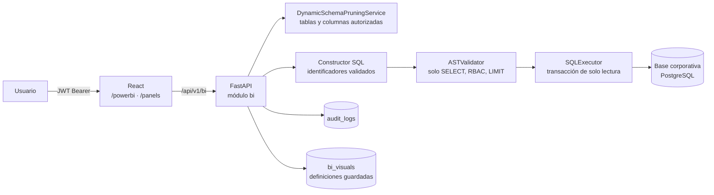

# Informe BI y Paneles

> **Documento:** Informe BI y Paneles
> **Estado:** ✅ Implementado y verificado (17/11/2026)
> **Última actualización:** 17 de noviembre de 2026
> **Producto:** Dat.ia 1.0.0 — analítica conversacional con IA local

Este documento explica cómo funciona el módulo nativo que reemplaza al panel
BI que se había implementado en PHP. No describe el PHP como si fuera parte de
Dat.ia: describe la versión FastAPI + React que ya corre en el producto.

El estado de cada plan vive en [`../plans/README.md`](../plans/README.md) y la
evidencia de la implementación está en el plan
[`011-informe-bi-nativo.md`](../plans/011-informe-bi-nativo.md).

---

## 1. Qué es

El módulo BI tiene dos pantallas dentro de Dat.ia:

1. **Informe BI (`/powerbi`)** — un informe automático sobre cualquier base
   incorporada. El usuario elige base y tabla; el sistema infiere una columna
   de fecha, una de agrupación y una de categoría, y arma un panel con KPIs,
   evolución, distribución, matriz diaria y detalle. No guarda nada: cada
   visita consulta la base en vivo.
2. **Paneles (`/panels`)** — un constructor de visuales guardados. El usuario
   elige tabla, tipo de gráfico, eje, medida, agregación, filtros y orden. La
   definición se guarda en `bi_visuals`; los datos se recalculan cada vez que
   se abre el panel.

La etiqueta **Power BI** se conserva en el menú y en el botón del chat por
continuidad con la entrega anterior. **No es Microsoft Power BI**: es un
informe BI nativo de Dat.ia. No se genera un `.pbix`, no se abre Power BI
Desktop y no se exporta a un servicio externo.

### Qué no es

- No es un iframe ni un segundo servidor web.
- No hay PHP, ni `php -S`, ni un puerto 8090, ni Chart.js copiado a mano.
- No hay un token viajando por `postMessage` ni por la URL.
- No escribe en la base del cliente. Solo ejecuta `SELECT`.
- No reemplaza al chat: lo complementa. El chat responde preguntas; el informe
  muestra una tabla completa con filtros.

---

## 2. Por qué se retira el PHP

La entrega de referencia funcionaba, pero duplicaba piezas que Dat.ia ya tiene:

| Problema del PHP | Consecuencia | Solución nativa |
|---|---|---|
| Proceso y sesión propios | Hay que levantar `php -S` aparte y pasarle el token al iframe. | La página React usa el mismo `apiClient` y el mismo `Authorization: Bearer`. |
| Lee el `.env` y descifra credenciales con Fernet | Duplica la lógica de `core/security.py` y de `connector_engine`. | El engine de conectores ya descifra y abre la conexión. |
| Consulta las tablas de permisos a mano | La gobernanza puede divergir de la del chat. | Usa `DynamicSchemaPruningService`, la misma fuente que el chat. |
| No escribe `audit_logs` | Una consulta a datos de cliente sin trazabilidad. | `_persist_audit_log(..., required=True)` en informe y visuales. |
| Soporta SQLite y PostgreSQL | Mantiene un motor que Dat.ia ya no usa. | Solo PostgreSQL; el resto responde 400 con un mensaje claro. |
| Chart.js vendorizado | Peso extra y otro estilo visual. | ECharts modular que ya usa el producto (`WidgetChart`). |
| No tiene tests | Cada cambio es una regresión posible. | Tests de API, gobernanza, seguridad, lógica pura y e2e. |

La carpeta `power bi/` de la entrega **no se copia al repositorio**. Se lee
como referencia de producto y se reimplementa.

---

## 3. Arquitectura



### Piezas

- **`src/pages/BIReportPage.tsx`** — informe automático. No es un iframe.
- **`src/pages/PanelsPage.tsx`** — constructor y paneles guardados.
- **`src/features/bi/services/bi_service.ts`** — llamadas a `/bi/*`.
- **`src/features/bi/report_logic.ts`** — cálculos puros del informe
  (porcentajes, flechas, pivotes, estado en la URL). Se testea sin navegador.
- **`backend/app/modules/bi/router.py`** — endpoints.
- **`backend/app/modules/bi/governance.py`** — resuelve la conexión, el rol y
  el esquema autorizado.
- **`backend/app/modules/bi/sql_builder.py`** — arma el SQL con identificadores
  y literales seguros.
- **`backend/app/modules/bi/report_service.py`** — ejecuta el informe completo,
  pivota y audita.
- **`backend/app/modules/bi/visual_service.py`** — ejecuta y guarda visuales.
- **`backend/app/modules/bi/models.py`** — tabla `bi_visuals`.

---

## 4. Flujo de una consulta del informe

1. El usuario entra a `/powerbi`, inicia sesión en Dat.ia y elige una base.
2. El frontend llama `GET /api/v1/bi/connections`. El backend devuelve solo las
   bases donde el perfil tiene al menos una tabla permitida (el admin ve todas
   las bases registradas).
3. Al elegir la base, `GET /api/v1/bi/schema?connection_id=...` devuelve las
   tablas y columnas visibles. Las columnas `BLOCKED` no aparecen. Las
   `MASKED` aparecen marcadas. Las columnas de `HIDDEN_COLUMNS` no aparecen
   nunca. La respuesta incluye `is_admin`: un no-admin no ve las `MASKED` en
   el informe; el admin sí. Ese booleano es solo para la UI: el backend valida
   cada solicitud y no confía en lo que el navegador muestre.
4. El usuario elige tabla y filtros. `GET /api/v1/bi/report` recibe:
   `connection_id`, `table`, `date_column`, `group_column`,
   `category_column`, `measure`, `year`, `month`, `group_value`,
   `category_value`.
5. El backend valida tabla y columnas contra el esquema autorizado (nunca
   contra el texto del request). Si no vienen, infiere:
   - fecha: primera columna de tipo fecha;
   - grupo: columna de texto con 3–30 valores distintos;
   - categoría: columna de texto con 2–10 valores distintos, distinta del
     grupo.
6. Construye cada consulta con identificadores entre comillas y valores como
   literales de `sqlglot`. Cada consulta pasa por `ASTValidator` y por
   `SQLExecutor`.
7. Pivota en Python la matriz grupo × día y el cruce grupo × categoría.
8. Devuelve el payload con KPIs, series, opciones de filtro, matriz, cruce,
   detalle y `audit_log_id`.
9. El frontend pinta las pestañas. El estado queda en la URL para poder
   compartir el enlace.

### Por qué se infiere con cardinalidades

Una tabla de ventas suele tener una columna de fecha, una de ejecutivo y una
de categoría. La heurística del PHP funcionaba: cuenta valores distintos de
cada columna de texto y elige la que tiene una cardinalidad razonable. Se
conserva, con dos límites:

- solo se inspeccionan hasta 12 columnas candidatas;
- si la consulta de cardinalidades falla, se responde 400 y se pide elegir
  las columnas a mano. No se adivina con datos que no se pudieron leer.

El usuario siempre puede cambiar fecha, grupo, categoría y medida en la barra
superior. La inferencia es una comodidad, no una verdad.

---

## 5. Las cinco pestañas

### 5.1 Resumen general

- **KPIs:** registros del período, total de la medida (con **delta contra el
  período anterior** y el valor anterior cuando hay historial), grupos con
  registros, días con datos, promedio diario y promedio por grupo.
- **Evolución:** línea diaria si hay un mes elegido; mensual si el filtro de
  mes está en `Todos`. **Clic en un mes fija ese mes** (drill).
- **Por grupo:** barras horizontales ordenadas de mayor a menor. **Clic en una
  barra filtra todo el informe por ese grupo**; clic de nuevo lo quita.
- **Distribución:** torta por categoría. **Clic filtra por esa categoría.**
- **Cruce grupo × categoría:** tabla con totales por fila y por columna. Si hay
  más de 12 categorías, el resto se agrupa en **Otros**; el total de cada fila
  es la suma de las celdas visibles, incluida Otros. **Clic en el rótulo de una
  fila filtra por ese grupo** (y es el camino accesible por teclado, igual que
  los selects del encabezado).

### 5.2 Detalle diario

- Matriz con una fila por grupo y una columna por día del mes elegido.
- **N°:** cantidad o suma de la medida para ese grupo y ese día.
- **% Particip.:** peso de esa celda sobre el total del día.
- Flechas: `↑` si la participación supera en 20 % la esperada, `→` si está
  cerca y `↓` si está por debajo. La referencia es `100 / cantidad de filas`.
- Evolución diaria y barras por grupo debajo de la matriz.

La matriz solo se muestra cuando hay fecha, grupo y un mes concreto. Si falta
alguno, la pestaña explica qué elegir en lugar de mostrar una tabla vacía.

### 5.3 Distribución

- Barras por categoría.
- Barras por grupo.
- Totales del período seleccionado.

### 5.4 Datos

- Primeras 200 filas con los filtros aplicados.
- Ordenadas por la columna de fecha, de la más reciente a la más antigua.
- Nunca incluye columnas `BLOCKED`, `MASKED` (para no-admin) ni
  `HIDDEN_COLUMNS`.

### 5.5 Guía de lectura

Explica con los nombres reales de la base qué significa cada pestaña, qué mide
la columna elegida y cómo leer la matriz. No es texto genérico: se arma con el
payload del informe.

---

## 6. Seguridad: los cuatro pilares

El módulo BI no inventa una capa de seguridad nueva. Se apoya en la que ya
existe.

### 6.1 Solo lectura

- El SQL se construye únicamente como `SELECT`.
- Pasa por `ASTValidator.validate_and_secure_sql`, que rechaza `INSERT`,
  `UPDATE`, `DELETE`, DDL, múltiples sentencias y funciones peligrosas.
- `SQLExecutor.execute_raw_sql` abre la conexión con
  `default_transaction_read_only=on` y vuelve a fijar
  `SET TRANSACTION READ ONLY` antes de ejecutar.
- El módulo no llama a `apply_null_policy` ni a ningún camino de escritura.

### 6.2 RBAC fail-closed

- `require_assigned_role` rechaza una cuenta sin rol y deja `RECHAZADO_RBAC` en
  auditoría.
- El esquema sale de `get_authorized_schema_prompt`. Si la gobernanza falla,
  no se devuelven tablas: se devuelve error.
- Un `connection_id` explícito que no existe es 404; no se cae a otra base.
- Una base sin tablas permitidas no aparece en `/bi/connections`; pedirla
  directamente da 403.

### 6.3 CLS / masking

- `BLOCKED`: se omite del esquema y el `ASTValidator` la rechaza si aparece en
  el SQL.
- `MASKED`: en el informe automático no se ofrece como campo a un no-admin.
  En paneles, un no-admin solo puede usarla para `count`/`count_distinct`, sin
  filtros, y la etiqueta se enmascara con `mask_value`. El administrador la ve
  en claro, igual que en el chat.
- `HIDDEN_COLUMNS`: lista local de nombres que nunca se muestran, ni siquiera
  al administrador (`password`, `hashed_password`, `encrypted_password`,
  `token`, `api_key`, `secret`, `secret_key`). Es defensa en profundidad.
- El detalle del informe y los visuales que devuelven filas llaman a
  `mask_query_rows` con el SQL ejecutado, incluso cuando el SELECT ya excluyó
  las columnas sensibles. Los agregados del informe (KPIs, series, matriz y
  cruce) se construyen solo con columnas autorizadas y no exponen valores
  individuales.

### 6.4 Trazabilidad

- El informe escribe **un** `AuditLog` por request, con el SQL de todas las
  consultas ejecutadas, el estado final (`APROBADO`, `RECHAZADO_RBAC` o
  `ERROR_EJECUCION`) y las filas del detalle.
- Cada visual guardado escribe su propio `AuditLog` por consulta.
- La escritura es obligatoria (`required=True`). Si falla, el endpoint
  responde 503 y no devuelve datos.
- `validation_status` nunca se rellena con un valor optimista: si no hay
  registro, es `NULL`.

---

## 7. Contrato de API

Todas las rutas viven bajo `/api/v1/bi` y exigen `Authorization: Bearer`.

### `GET /bi/connections`

```json
[
  {"id": 1, "name": "Demo", "db_type": "postgresql", "is_active": true}
]
```

### `GET /bi/schema?connection_id=1`

```json
{
  "connection_id": 1,
  "connection_name": "Demo",
  "is_admin": false,
  "tables": [
    {
      "name": "fact_ventas",
      "columns": [
        {"name": "fecha", "type": "date", "kind": "date", "masked": false},
        {"name": "monto", "type": "numeric", "kind": "number", "masked": true}
      ]
    }
  ]
}
```

### `GET /bi/report`

Parámetros: `connection_id`, `table`, `date_column`, `group_column`,
`category_column`, `measure`, `year`, `month`, `group_value`,
`category_value`.

Devuelve `connection`, `table`, `roles`, `period`, `options`, `kpis`,
`by_group`, `by_category`, `daily`, `matrix`, `cross`, `detail` y
`audit_log_id`.

### Visuales

| Método | Ruta | Qué hace |
|---|---|---|
| `POST` | `/bi/query` | Vista previa de un visual. |
| `GET` | `/bi/visuals?panel_name=` | Visuales del usuario. |
| `POST` | `/bi/visuals` | Guarda un visual (lo ejecuta antes). |
| `PUT` | `/bi/visuals/{id}` | Edita un visual (lo vuelve a ejecutar antes de aceptar el cambio). |
| `PUT` | `/bi/visuals/positions` | Fija el orden de los visuales de un panel y devuelve el panel ordenado. |
| `POST` | `/bi/visuals/{id}/data` | Recalcula un visual guardado. |
| `DELETE` | `/bi/visuals/{id}` | Borra un visual del usuario. |

`BIVisualSpec`:

```json
{
  "connection_id": 1,
  "table": "fact_ventas",
  "chart_type": "bar",
  "dimension": "categoria",
  "date_grain": null,
  "measure": "monto",
  "aggregation": "sum",
  "filters": [{"column": "ejecutivo", "op": "=", "value": "Ana"}],
  "sort": "value_desc",
  "limit": 20
}
```

---

## 8. Paneles guardados

Un panel es una colección de visuales de un usuario. No es un dashboard
compartido: cada usuario ve los suyos. El administrador no ve los paneles de
otra persona.

- **Guardar** guarda la **definición** (tabla, campos, agregación, filtros,
  orden), no una foto de los datos.
- **Abrir** recalcula cada visual contra la base actual y con los permisos
  actuales. Si un permiso cambió, el visual muestra el error o los datos
  nuevos, no datos viejos.
- **Editar** abre el mismo constructor con la definición cargada (lápiz en la
  tarjeta). Antes de aceptar el cambio, el backend **vuelve a ejecutar la
  consulta** con los permisos de hoy: nunca queda guardada una definición que
  el usuario ya no puede ver. También permite mover el visual a otro panel
  cambiando el campo "Guardar en el panel".
- **Mover** reordena los visuales del panel de dos formas: arrastrando la
  tarjeta (HTML5 nativo, sin librerías) o con los botones ↑ / ↓, que son el
  camino accesible por teclado. El orden se guarda solo con un `PUT` que envía
  la lista completa del panel, así un fallo de red deja el orden anterior en
  vez de un orden a medias.
- **Tamaño** en el panel: ⅓ (estrecho, por defecto), ⅔ (ancho) o completo.
  Los visuales guardados antes de este campo siguen siendo ⅓.
- **Descargar CSV** baja EXACTAMENTE lo que se ve en la tarjeta (mismo
  endpoint auditado `/visuals/{id}/data`), armado en el cliente y con los
  prefijos de fórmula (`=`, `+`, `-`, `@`) escapados igual que el backend
  hace en los exports de Excel.
- **Borrar** quita la definición. No toca la base corporativa.
- **Límite:** 100 visuales por usuario.
- **Tipos:** columnas, barras, líneas, área, torta, tarjeta KPI y tabla.
- **Filtros:** máximo 5; operadores `=`, `!=`, `>`, `<`, `>=`, `<=`,
  `contains`.
- **Gránulo de fecha:** día, mes o año.

### Reglas de columnas en paneles

| Columna | Dimensión | Medida | Filtro |
|---|---|---|---|
| Visible | Sí | Sí | Sí |
| `MASKED` (no-admin) | Sí, etiqueta enmascarada | Solo `count`/`count_distinct` | No |
| `MASKED` (admin) | Sí | Sí | Sí |
| `BLOCKED` | No | No | No |
| `HIDDEN_COLUMNS` | No | No | No |

La regla de `MASKED` es deliberadamente conservadora: agrupar por una columna
enmascarada puede revelar sus valores aunque la etiqueta se tape; sumar o
promediar una columna enmascarada puede revelar un agregado sensible. Si el
caso de uso necesita más, se discute en un plan aparte, no se relaja aquí.

---

## 9. Estado en la URL

`/powerbi` guarda el estado en la URL para que el enlace se pueda compartir:

| Parámetro | Significado |
|---|---|
| `conn` | ID de la conexión |
| `table` | Tabla |
| `date` | Columna de fecha (`-` = sin fecha) |
| `group` | Columna de agrupación |
| `cat` | Columna de categoría |
| `measure` | Medida (`count` o columna numérica) |
| `year` | Año |
| `month` | Mes o `all` |
| `gv` | Valor del filtro de grupo |
| `cv` | Valor del filtro de categoría |
| `tab` | Pestaña activa |

El botón **Power BI** del chat navega a
`#/powerbi?conn=ID&table=TABLA`. La página aplica esos valores al cargar. El
resto de los parámetros se conserva al cambiar filtros.

No se usa la URL para pasar el token. El token vive en `localStorage` y viaja
solo en la cabecera `Authorization`, como en el resto de Dat.ia.

---

## 10. Límites y decisiones conscientes

- **Solo PostgreSQL.** `DatabaseType` solo admite PostgreSQL y las cargas se
  convierten a PostgreSQL. Una conexión de otro motor responde 400.
- **Detalle de 200 filas.** Es una vista de revisión, no una exportación.
- **Hasta 500 filas por consulta** por el guardarraíl `DEFAULT_ROW_LIMIT`.
- **Hasta 25 grupos y 12 categorías** en las series, para que el gráfico se
  lea. En el cruce, el resto de las categorías se agrupa en **Otros** para que
  los totales cuadren con lo visible.
- **Sin exportación** a PDF, Excel o Power BI. Si se necesita, se planifica
  aparte con los mismos pilares.
- **Sin caché de resultados.** El informe se recalcula en cada visita. Es más
  lento que una foto, pero siempre muestra los datos y permisos actuales.
- **Un registro de auditoría por informe.** El `sql_generated` contiene todas
  las consultas; no se crea una fila por cada una para no inundar
  `audit_logs` con diez eventos por clic.
- **Cardinalidades exactas.** La autoselección usa `COUNT(DISTINCT)`; en
  tablas enormes puede tardar. El usuario puede elegir las columnas a mano.
- **Nombres de columna repetidos.** La gobernanza actual expone `BLOCKED` y
  `MASKED` por nombre de columna, no por `tabla.columna`. Si dos tablas tienen
  una columna con el mismo nombre, se oculta en ambas. Es fail-closed: se
  oculta de más, nunca de menos.

---

## 11. Mapa de la migración

| PHP / entrega | Nativo |
|---|---|
| `config.php` (env, PDO, Fernet) | `core/config.py`, `connector_engine`, `core/security.py` |
| `current_user()` (cURL a `/auth/me`) | `get_current_user` + `require_assigned_role` |
| `permissions()` (SQL directo a permisos) | `DynamicSchemaPruningService.get_authorized_schema_prompt` |
| `fernet_decrypt()` | `decrypt_credential` dentro de `build_engine_for_connector` |
| `pg_pdo()` / `metadata_pdo()` | `SessionLocal`, `connector_engine` |
| `read_schema()` | servicio de esquema del módulo `bi` |
| `build_dashboard()` | `report_service.py` |
| `api.php` (router) | `bi/router.py` |
| `index.php` (HTML + Chart.js) | `BIReportPage.tsx` + `WidgetChart` (ECharts) |
| `PowerBIPage.tsx` (iframe) | ruta nativa `/powerbi` |
| `PanelsPage.tsx` | `PanelsPage.tsx` adaptada |
| `bi_service.ts` | `features/bi/services/bi_service.ts` |
| `bi_panels/models.py` | `bi/models.py` (`BIVisual`) |
| `bi_panels/router.py` | `bi/router.py` + `visual_service.py` |
| `path_repair.py` | no se porta (no hay SQLite) |
| `exportar_powerbi.py` | no se porta (exportación real fuera de alcance) |
| `INSTALAR_POWERBI_PANELES.txt` | no se porta (ya no hay PHP) |

---

## 12. Cómo se verifica

Cuando el plan 011 se ejecute, la verificación es:

```powershell
cd backend
venv\Scripts\python.exe -m pytest -q

cd ..
npx tsc --noEmit
npm test
npm run build
npm run test:e2e
```

Además, pruebas manuales mínimas:

1. Login como `admin`; abrir **Power BI**; elegir la base demo y
   `fact_ventas`; ver KPIs y las cinco pestañas.
2. Cambiar año, mes y grupo; comprobar que el detalle cambia.
3. Hacer una consulta en el chat y pulsar **Power BI**; comprobar que abre la
   base y la tabla correctas.
4. Login con un usuario sin permisos a una base; comprobar que no aparece en
   el selector y que pedirla por URL da error.
5. En **Paneles**, crear un visual, guardarlo, recargar y borrarlo.

La salida real de estos comandos es la única evidencia válida. Un documento o
un plan no reemplazan la ejecución.

---

## 13. Cómo extenderlo

- **Otro tipo de gráfico:** agregar el valor al `Literal` de `chart_type` y un
  caso en `VisualRenderer`; no tocar la construcción de SQL si el spec no
  cambia.
- **Otra agregación:** agregar al `Literal` de `aggregation` y al mapa de
  `sql_builder`; actualizar la lista de la UI y el test de contrato.
- **Otra métrica del informe:** primero agregar el campo al payload de
  `report_service` y al tipo de `bi_service`; después pintarlo. No calcular
  métricas de negocio en el frontend si dependen de la base.
- **Otro motor de base:** es un cambio de `DatabaseType`, del engine y del
  dialecto del `ASTValidator`; no se resuelve con un `if` en el módulo BI.
- **Exportación:** va en `reports` o en un módulo nuevo, con `mask_query_rows`
  y auditoría. No reutilizar `exportar_powerbi.py`.

---

## 14. Glosario

- **Base incorporada:** conexión registrada en Dat.ia (PostgreSQL o dataset
  subido y convertido a PostgreSQL).
- **Informe BI:** vista automática de una tabla, sin guardar definición.
- **Panel:** colección de visuales guardados por un usuario.
- **Visual:** una definición guardada (tabla, campos, agregación, filtros,
  tipo de gráfico).
- **BLOCKED:** columna que el perfil no puede ver ni consultar.
- **MASKED:** columna que el perfil puede consultar, pero cuyo valor se
  enmascara antes de salir.
- **HIDDEN_COLUMNS:** lista local de columnas que nunca se muestran, incluso
  al administrador.
- **Fail-closed:** ante un error o una duda, se niega el acceso; nunca se
  concede por defecto.

---

## 15. Referencias

- Plan de ejecución: [`../plans/011-informe-bi-nativo.md`](../plans/011-informe-bi-nativo.md)
- Estado de los planes: [`../plans/README.md`](../plans/README.md)
- Arquitectura general: [`02_ARQUITECTURA_TECNICA.md`](02_ARQUITECTURA_TECNICA.md)
- Permisos y seguridad: [`03_SISTEMA_DE_PERMISOS_Y_SEGURIDAD.md`](03_SISTEMA_DE_PERMISOS_Y_SEGURIDAD.md)
- Manual de usuario: [`27_MANUAL_DE_USUARIO.md`](27_MANUAL_DE_USUARIO.md)

---

## 16. Estado de implementación

Implementado y verificado el 17/11/2026:

- Backend: `backend/app/modules/bi/` con `governance.py`, `sql_builder.py`,
  `report_service.py`, `visual_service.py`, `models.py`, `schemas.py` y
  `router.py`; endpoints bajo `/api/v1/bi`, incluida la edición
  (`PUT /bi/visuals/{id}`) y el reordenado (`PUT /bi/visuals/positions`).
- Frontend: `src/pages/BIReportPage.tsx`, `src/pages/PanelsPage.tsx` (crear,
  editar, arrastrar y reordenar visuales) y `src/features/bi/`.
- Rutas `/powerbi` y `/panels`, botones en el header y botón Power BI en el
  chat.
- Interacción tipo Power BI (plan 012): cross-filtering con clic y toggle,
  drill de mes, KPI con delta y valor anterior, tamaños ⅓/⅔/completo,
  descarga CSV del visual y ejes compactos.
- Evidencia: pytest **1136 passed, 264 subtests**; vitest **26 archivos / 211
  tests**; `tsc --noEmit` exit 0; build exit 0; e2e **12 passed + 1 skipped**.
- No se agregaron dependencias y no queda PHP en el flujo.

