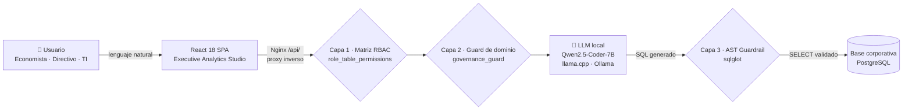

<p align="center">
  
</p>

<h1 align="center">🌌 Datia — Democratización de Datos Corporativos con IA Local 100% Offline</h1>

<p align="center">
  
  
  
  
  
  
  
</p>

Plataforma empresarial de analítica conversacional y **Executive Analytics Studio** que permite a usuarios no técnicos (Economistas, Directivos, Analistas) y equipos de TI realizar consultas complejas sobre bases de datos corporativas en **lenguaje natural**, garantizando privacidad absoluta mediante **IA Local (Qwen2.5-Coder / llama.cpp)** y gobernanza con **AST Guardrails & Column-Level Security (CLS)**.

---

## ⚙️ Cómo Funciona



---

## 🚀 Características Principales

| | |
| :--- | :--- |
| 🧠 **IA Local 100% Offline** *(Zero Data Leakage)* | Sin dependencias de APIs en la nube. Compatible con `llama.cpp` y `Ollama` ejecutando modelos GGUF cuantizados (`Qwen2.5-Coder-7B`). |
| 📊 **Executive Analytics Studio** | Visualizador interactivo con cambio en vivo de gráficos (Barras con esquinas redondeadas, Áreas con Glow, Donut concéntrico 3D, Líneas y Velocímetros/Gauges), selector de paletas de color y ordenamiento dinámico. |
| 📑 **Informes Ejecutivos Cuantitativos** | Generación automática de diagnósticos estratégicos C-Level con cifras exactas, márgenes porcentuales, hallazgos clave, recomendaciones accionables y dictamen de nivel de riesgo. |
| 🛡️ **Gobernanza & AST Guardrail** | Análisis del árbol de sintaxis abstracta con `sqlglot` para forzar consultas de solo lectura (`SELECT` único), bloqueando cualquier comando destructivo (`DROP`, `DELETE`, `UPDATE`, `INSERT`). |
| 🔐 **RBAC & Column-Level Security** | Enmascaramiento y bloqueo de columnas confidenciales (tokens de pago, API keys, RUTs, IBANs) según el perfil del usuario (`Economista`, `TI`, `Administrador`). |
| ⚡ **Arquitectura Web Monorepo** | Frontend de alta gama en **React 18 + TypeScript + Vite + TailwindCSS + Apache ECharts** conectado a un backend de alto rendimiento en **Python FastAPI + SQLAlchemy + PostgreSQL**, empaquetado para despliegue con Docker (Nginx como servidor de estáticos y proxy inverso al backend). |

---

## 📚 Documentación

La documentación completa vive en [`DOCS/`](DOCS/README.md), con enlaces relativos y diagramas Mermaid. Estos son los 17 entregables:

| # | Entregable | Documento | Qué encontrarás |
|---:|---|---|---|
| 1 | Documento de inicio | [`DOCS/12_DOCUMENTO_DE_INICIO.md`](DOCS/12_DOCUMENTO_DE_INICIO.md) | Problema, objetivos, alcance, interesados, riesgos y plan de Fase 1 |
| 2 | Metodología | [`DOCS/13_METODOLOGIA.md`](DOCS/13_METODOLOGIA.md) | Scrum, roles, ceremonias y límites de aplicación |
| 3 | Product Vision | [`DOCS/14_PRODUCT_VISION.md`](DOCS/14_PRODUCT_VISION.md) | Visión, usuarios, propuesta de valor y métricas |
| 4 | Product Backlog | [`DOCS/15_PRODUCT_BACKLOG.md`](DOCS/15_PRODUCT_BACKLOG.md) | 66 historias en 10 épicas, con evidencia y estado |
| 5 | Sprint Backlog | [`DOCS/16_SPRINT_BACKLOG.md`](DOCS/16_SPRINT_BACKLOG.md) | 5 iteraciones reconstruidas desde 144 commits |
| 6 | Definition of Done | [`DOCS/17_DEFINITION_OF_DONE.md`](DOCS/17_DEFINITION_OF_DONE.md) | Checklist de terminado y comandos de evidencia |
| 7 | Retrospectivas | [`DOCS/18_RETROSPECTIVAS.md`](DOCS/18_RETROSPECTIVAS.md) | 4 retrospectivas y acciones abiertas |
| 8 | SRS | [`DOCS/19_SRS.md`](DOCS/19_SRS.md) | 81 requisitos funcionales, criterios y matriz de trazabilidad |
| 9 | README | Este archivo | Qué es, cómo se levanta y cómo se verifica |
| 10 | Arquitectura | [`DOCS/02_ARQUITECTURA_TECNICA.md`](DOCS/02_ARQUITECTURA_TECNICA.md) | Capas, componentes y decisiones técnicas |
| 11 | Modelo de datos | [`DOCS/21_MODELO_DE_DATOS.md`](DOCS/21_MODELO_DE_DATOS.md) | 13 tablas de metadata + 9 demo, ER, diccionario y cascadas |
| 12 | Diagramas UML | [`DOCS/22_DIAGRAMAS_UML.md`](DOCS/22_DIAGRAMAS_UML.md) | Casos de uso, componentes, clases, secuencias, estados y despliegue |
| 13 | Requisitos no funcionales | [`DOCS/20_REQUISITOS_NO_FUNCIONALES.md`](DOCS/20_REQUISITOS_NO_FUNCIONALES.md) | 77 RNF con objetivo, verificación y estado |
| 14 | Docker y despliegue | [`DOCS/26_DOCKER.md`](DOCS/26_DOCKER.md) | Tres compose, imágenes, puertos, backup y seguridad |
| 15 | Pruebas | [`DOCS/24_PRUEBAS.md`](DOCS/24_PRUEBAS.md) | Suite, cobertura real, CI y deuda declarada |
| 16 | Manual técnico | [`DOCS/23_MANUAL_TECNICO.md`](DOCS/23_MANUAL_TECNICO.md) | Instalación, API, tareas frecuentes y troubleshooting |
| 17 | Innovación | [`DOCS/25_INNOVACION.md`](DOCS/25_INNOVACION.md) | Aportes diferenciales y lo que no es innovación |

| Recurso | Documento |
|---|---|
| Hub de documentación | [`DOCS/README.md`](DOCS/README.md) |
| Guía rápida Docker (sin Node ni Python) | [`DOCKER-RAPIDO.md`](DOCKER-RAPIDO.md) |
| Instalación on-prem, TLS, backup y upgrade | [`deploy/README.md`](deploy/README.md) |
| Planes de implementación | [`plans/README.md`](plans/README.md) |
| Evidencias académicas de Fase 1 | [`DOCS/entregables-academicos/fase-1/`](DOCS/entregables-academicos/fase-1/) |

> **Visión vs. producto:** lo que está planificado pero no implementado se marca explícitamente en cada documento. El README y `DOCS/` no presentan visión como funcionalidad entregada.

---

## 🛠️ Stack Tecnológico

| Capa | Tecnologías |
| :--- | :--- |
| **Frontend** | React 18, React Router 7, TypeScript, Vite, Tailwind CSS, Lucide Icons, Apache ECharts (`echarts-for-react`) |
| **Backend** | Python 3.10+, FastAPI, Uvicorn, SQLAlchemy, Pydantic v2, sqlglot (AST Security) |
| **Bases de Datos** | PostgreSQL (`psycopg[binary]`) como motor único; los archivos `.sqlite`, `.csv` y `.xlsx` se importan a PostgreSQL |
| **IA Local** | llama.cpp / Ollama / LM Studio (API compatible con OpenAI), `Qwen2.5-Coder-7B-Instruct-GGUF` |
| **Despliegue** | Docker + Docker Compose, Nginx como servidor de estáticos y proxy inverso |

### Fuentes de datos: implementado vs. planificado

`CorporateConnection.db_type` solo admite **PostgreSQL** (`backend/app/modules/admin_catalog/models.py:7`), y `backend/requirements.txt` solo trae `psycopg[binary]`. Los siguientes motores aparecen en la documentación de visión (DOCS 01/02/06) pero **no están implementados**: no hay driver en `requirements.txt` ni rama que los construya en `core/database.py:build_engine_for_connector`.

| Motor | Estado |
| :--- | :--- |
| PostgreSQL | ✅ Implementado |
| SQLite (subida de archivo `.sqlite`) | ⬆️ Se importa a PostgreSQL al subirlo |
| MySQL / MariaDB (`pymysql`) | ❌ No implementado |
| Microsoft SQL Server (`pymssql` / `pyodbc`) | ❌ No implementado |

---

## 📦 Puesta en Marcha

### Instalación on-prem (una empresa por instalación)

Es el modo de entrega a un cliente: recibe un **bundle de instalación** y las
imágenes de contenedor publicadas en GHCR. No necesita el repositorio ni tener
Node.js o Python instalados en el host.

#### Programas que necesita el host

| Programa | Versión | Para qué |
| :--- | :--- | :--- |
| Docker Engine | 24 o superior | ejecutar los contenedores |
| Docker Compose (plugin `docker compose`) | 2.20 o superior | orquestar el stack |
| `openssl` | reciente | **solo** `setup.sh`: genera secretos y la clave del admin |
| `tar` y `gzip` | estándar | extraer el bundle y los backups |
| Driver NVIDIA + NVIDIA Container Toolkit | opcional | Ollama con GPU (`docker-compose.gpu.yml`) |

No hace falta instalar PostgreSQL, Ollama, Nginx ni Caddy en el host: corren
como contenedores. `curl` ya viene dentro de la imagen del backend para el
healthcheck.

| Recurso | Mínimo | Recomendado |
| :--- | :--- | :--- |
| CPU | 4 vCPU | 8 vCPU |
| RAM | 8 GB | 16 GB para un modelo 7B en CPU |
| Disco | 20 GB libres | 50 GB o más (modelos e imágenes) |
| SO | Linux x86_64/arm64 con Docker | Ubuntu 22.04/24.04 LTS |

La RAM del modelo no está limitada en el compose: 7B cuantizado (Q4) usa ~5 GB,
14B necesita 16 GB libres y 32B unos 32 GB, más 2–4 GB para el resto del stack.
Si el host es compartido, límite Ollama con un override de compose; un límite
menor al que necesita el modelo lo hace fallar al cargarlo.

#### Pasos de instalación

1. **Descargue el bundle** desde la página de releases
   (`https://github.com/Kintsukuro1/Datia/releases`) y extráigalo:

   ```sh
   tar -xzf datia-deploy-<tag>.tar.gz
   cd datia-deploy-<tag>
   ```

2. **Autentíquese en GHCR** si los paquetes de imagen son privados. Necesita un
   token de GitHub con `read:packages`:

   ```sh
   echo "<PAT-con-read:packages>" | docker login ghcr.io -u <usuario-github> --password-stdin
   ```

3. **Ejecute el instalador**. Genera `.env` con secretos aleatorios, valida el
   host, descarga las imágenes, levanta el stack, baja el modelo y crea el
   primer administrador:

   ```sh
   ./setup.sh
   ```

   La clave inicial del admin se imprime **una sola vez** al final. Guárdela.

4. **Entre a la aplicación** en `http://127.0.0.1:8080` (por defecto solo
   escucha en loopback). En el primer login el sistema obliga a cambiar la
   clave temporal.

5. **Configure el acceso a los datos** desde la interfaz: conexión a
   PostgreSQL corporativo y catálogo. Para la base del cliente use un usuario
   de solo lectura:

   ```sql
   CREATE USER datia_ro WITH PASSWORD '<clave>';
   GRANT CONNECT ON DATABASE <base> TO datia_ro;
   GRANT USAGE ON SCHEMA public TO datia_ro;
   GRANT SELECT ON ALL TABLES IN SCHEMA public TO datia_ro;
   ALTER DEFAULT PRIVILEGES IN SCHEMA public GRANT SELECT ON TABLES TO datia_ro;
   ```

#### Qué editar en `.env`

`setup.sh` crea el `.env` y rellena los secretos. Después de la instalación
solo se editan las variables de operación:

| Variable | Cuándo cambiarla |
| :--- | :--- |
| `DATIA_BIND_IP` / `DATIA_HTTP_PORT` | Publicar el frontend en la LAN (`127.0.0.1` por defecto) o cambiar el puerto |
| `TRUSTED_PROXY_CIDR` | Si hay un LB/ingress delante: CIDR desde el que llega el `X-Forwarded-For` |
| `LLM_MODE` | `central` (Ollama del compose), `external` (Ollama de la empresa) o `user` (cada usuario elige su LLM) |
| `OLLAMA_BASE_URL` / `OLLAMA_MODEL` | Motor administrado y modelo (también con `LLM_PROVIDER=openai_compatible`) |
| `LLM_PROVIDER` / `OPENAI_COMPATIBLE_URL` | vLLM, LM Studio o gateway corporativo compatible con OpenAI |
| `COMPOSE_PROFILES=caddy` + `DATIA_DOMAIN` | TLS automático con Caddy (abra 80/443) |
| `DATIA_SKIP_PULL=1` | Instalación air-gapped: usa imágenes ya cargadas con `docker load` |
| `DATIA_SKIP_MODEL_PULL=1` | Air-gapped: no intentar descargar el modelo de Ollama; cárguelo antes |

No cambie `FERNET_KEY` después de guardar credenciales de conectores: las
claves cifradas quedan ilegibles y hay que recifrarlas. `SECRET_KEY` sí se puede
rotar, pero invalida las sesiones activas.

#### Operación

```sh
./backup.sh                              # metadata + data_sources + .env
./restore.sh backups/<stamp>.dump --yes  # reemplaza la instalación actual
./upgrade.sh                             # tras cambiar el tag en .env
```

El detalle completo (TLS, air-gapped, rollback, visibilidad de imágenes y
solución de problemas) está en [`deploy/README.md`](deploy/README.md).

---

### Desarrollo local

#### 1. Requisitos previos

- Node.js v18+ y npm
- Python 3.10+
- *(Opcional para IA Local)* `llama.cpp` o `Ollama` con el modelo `Qwen2.5-Coder-7B-Instruct`

#### 2. Instalar dependencias (2 pasos)

```bash
# 1. Dependencias del Frontend
npm install

# 2. Entorno virtual y dependencias del Backend
cd backend
python -m venv venv
# Windows: venv\Scripts\activate | Linux/macOS: source venv/bin/activate
pip install -r requirements.txt
cd ..
```

#### 3. Iniciar la aplicación (frontend + backend concurrentes)

```bash
npm run dev
```

| Servicio | URL |
| :--- | :--- |
| 🖥️ Frontend | `http://localhost:5173/` |
| 📚 Backend API Docs | `http://127.0.0.1:8000/docs` |

> [!NOTE]
> **Datos demo**
> La plataforma usa PostgreSQL como motor único; no hay base SQLite ni script
> generador. `python backend/scripts/setup_postgres_full.py` crea y siembra las
> dos bases de la demo (`democratizacion_metadatos` y `democratizacion_empresa`),
> y `app/db/init_db.py` repite el seed en el primer arranque si hace falta.

#### 4. Alternativa: Docker Compose (desarrollo)

```bash
cp .env.example .env
# Rellenar FERNET_KEY y POSTGRES_PASSWORD, y cambiar SECRET_KEY
docker compose up -d
```

> [!WARNING]
> `docker-compose.yml` exige `FERNET_KEY` y `POSTGRES_PASSWORD` con `:?`: si faltan o
> vienen vacíos, compose se niega a arrancar. Además hay que cambiar `SECRET_KEY`:
> compose arranca con `ENVIRONMENT=production` y el backend rechaza la clave de
> desarrollo del repositorio.
>
> Generar una `FERNET_KEY` nueva:
> `python -c "from cryptography.fernet import Fernet; print(Fernet.generate_key().decode())"`

El frontend queda en `http://127.0.0.1/` (publicado solo en loopback) y Nginx hace de proxy inverso hacia el backend en `http://backend:8000`.

> **Este compose es de desarrollo.** Para entregar una instalación a un
> cliente use el bundle on-prem descrito arriba; el detalle operativo está en
> [`deploy/README.md`](deploy/README.md).

> Si algo falla al levantar el stack (puertos, secretos, volúmenes), los
> problemas frecuentes y su diagnóstico están en [`DOCKER-RAPIDO.md`](DOCKER-RAPIDO.md).

---

## 🧪 Pruebas y verificación

| Comando | Qué prueba | Resultado medido (30/10/2026) |
| :--- | :--- | :--- |
| `cd backend; venv\Scripts\python.exe -m pytest -q` | Backend completo sobre PostgreSQL real | **844 passed, 244 subtests, 0 failed** (6:36) |
| `npm test` | Lógica del frontend (Vitest) | **18 archivos, 135 tests, 0 failed** (6,56 s) |
| `npx tsc --noEmit` | Tipos de todo el proyecto | **exit 0** |
| `npm run build` | Build de producción | **exit 0** (10,72 s; warning esperado de echarts 665,26 kB) |

- La suite de backend **no arranca sin PostgreSQL** en `localhost:5432`: crea bases temporales reales, no usa mocks.
- CI corre backend, frontend, typecheck y build en cada push/PR (`.github/workflows/ci.yml`).
- **Lo que no está cubierto:** specifications E2E de Playwright, renderizado de componentes React, lint bloqueante y umbral de cobertura. Está declarado en [`DOCS/24_PRUEBAS.md`](DOCS/24_PRUEBAS.md) y en [`DOCS/20_REQUISITOS_NO_FUNCIONALES.md`](DOCS/20_REQUISITOS_NO_FUNCIONALES.md).

> Si una cifra no coincide con tu corrida, la fuente de verdad es el comando, no este número. El detalle de la estrategia y el mapa de tests está en [`DOCS/24_PRUEBAS.md`](DOCS/24_PRUEBAS.md).

---

## 🔑 Credenciales de Acceso Demo

Los permisos se otorgan por **responsabilidad funcional**, no por título personal. Cada perfil ve las tablas de su área y el resto le responde con un denegado de gobernanza que nombra el motivo.

| Rol corporativo | Usuario | Contraseña | Acceso de Datos |
| :--- | :--- | :--- | :--- |
| 🛠️ **Administrador de Plataforma** | `admin` | `admin123` | Control total RBAC, conexiones y auditoría |
| 👔 **Director Ejecutivo (C-Level)** | `director` | `director123` | Rentabilidad consolidada y catálogo. Sin el detalle transaccional |
| 📈 **Analista Financiero & Comercial** | `economista` | `economista123` | Finanzas, ventas, clientes, facturación y encuestas |
| 🤝 **Gerente de Talento & Operaciones** | `talento` | `talento123` | Plantilla (incluye sueldos) y encuestas. Sin ventas |
| 📊 **Analista de Datos & BI** | `bi` | `bi123` | Infraestructura y plantilla (sin remuneraciones). Sin datos financieros ni catálogo comercial |
| 🖥️ **Ingeniero de Infraestructura & TI** | `ti` | `ti123` | Infraestructura, servidores, incidentes, plantilla (sin remuneraciones) y encuestas |
| 🔎 **Oficial de Cumplimiento & Seguridad** | `seguridad` | `seguridad123` | Trazabilidad técnica y catálogo. Sin márgenes de venta |
| 🧭 **Usuario Consultor** | `consultor` | `consultor123` | Solo lectura del catálogo de productos y encuestas |

- Ningún rol ve el detalle transaccional (`fact_ventas`) salvo el Administrador y el Analista Financiero: el resto recibe un denegado con el motivo.
- Existen dos cuentas adicionales para pruebas automatizadas que no aparecen en el login: `felipe_economista` y `juan_ti`.
- El login incluye un desplegable con estos ocho perfiles: al elegir uno se rellenan las credenciales y el acceso ocurre al pulsar **Acceder al Sistema**.

> [!IMPORTANT]
> Estas cuentas existen solo cuando el seed de demostración está activo (`DEMO_MODE=true`, o por defecto fuera de `production`). En Docker, compose arranca con `ENVIRONMENT=production` y `DEMO_MODE=false` **por defecto**: sin seed no hay cuentas con claves publicadas. En una instalación on-prem el único acceso inicial es el admin que crea `setup.sh`.

---

## 📐 Casos de Uso y Gobernanza

El sistema incluye separación estricta de dominios:

- **Economía & Finanzas:** acceso a `dim_categorias`, `dim_productos`, `dim_clientes`, `fact_ventas`, `fact_ingresos_costos`, `dim_empleados`.
- **Tecnología & TI:** acceso a `dim_servidores`, `fact_incidentes_ti`, `fact_consumo_recursos`.
- **Column-Level Security:** `tarjeta_credito_token` y `api_key_servicio` restringidos exclusivamente a superadministradores.

La gobernanza aplica en **tres capas**, y cada una frena por su cuenta:

| # | Capa | Qué frena |
| :--- | :--- | :--- |
| **1** | **Matriz de permisos** (`role_table_permissions`) | Define qué tablas ve cada rol. Es la capa que hace el aislamiento. |
| **2** | **Guard de dominio** (`governance_guard`) | Además de la tabla, frena el *tema* de la pregunta. El C-Level tiene bypass de dominio por diseño, así que en su caso solo lo frena la capa 1. |
| **3** | **Validador AST** (`sqlglot`) | Si el LLM genera SQL contra una tabla fuera de la matriz, la consulta se rechaza antes de llegar a la base, aunque la pregunta haya pasado el filtro de palabras clave. |

Las tres capas deciden **qué tablas** se pueden consultar. La clasificación de **columnas** (`role_column_permissions`) se edita por conexión en *Administración → Permisos*: cada columna real del diccionario puede quedar **Permitida**, **Enmascarada** o **Bloqueada** para un rol, o volver a **Sin política** (borra la fila y la deja en el default legible; es la única forma de deshacer una **Permitida** explícita). Un dataset subido nace sin políticas de columna, así que el admin las clasifica ahí; una **Permitida** explícita sobre una columna que el seed bloquea es una excepción que sobrevive al siguiente arranque, y es la vía para que un rol de RRHH creado a mano vea remuneraciones.

El alcance de una política es la **conexión**: el guard resuelve BLOCKED/MASKED por nombre de columna, así que si dos tablas comparten el nombre gana la política más restrictiva (Bloqueada &gt; Enmascarada &gt; Permitida). Es la postura fail-closed: sobre-bloquear se nota; filtrar, no. El selector muestra la fila de la tabla elegida y avisa cuando otra tabla de la conexión impone una política más restrictiva, para que un "Permitida" no se lea como un cambio de efecto que el chat no va a aplicar.

Cada cambio de tabla o de política de columna queda registrado en `audit_logs` (`PERMISOS_TABLA` / `PERMISOS_COLUMNA`) con el rol, la conexión y las columnas afectadas; el reset a **Sin política** solo audita cuando borró una fila. En *Administración → Auditoría* se filtra por esos eventos, por familia de acceso (`AUTH_*`), exportaciones (`EXPORTADO_*`), proyecciones (`PROYECCION_*`), política de nulos (`NULL_POLICY_*`) y errores (`ERROR_*`), y el inspector muestra el detalle. El listado no transporta los snapshots de consultas, que pesan hasta ~100 KB cada uno.

La exportación CSV conserva el detalle de los eventos de permisos en la columna **Detalle del Evento** y carga en memoria solo las columnas que escribe (no los snapshots de todas las filas). El tope de 50.000 filas sigue vigente por memoria; si el filtro supera ese tope, el archivo agrega una fila **AVISO** al final con el total real para que no se confunda un export truncado con uno completo.

---

## 📄 Licencia

Desarrollado con fines corporativos y de investigación en democratización de datos seguros con modelos de lenguaje locales.
