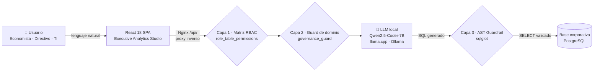

<p align="center">
  
</p>

<h1 align="center">🌌 Datia — Democratización de Datos Corporativos con IA Local 100% Offline</h1>

<p align="center">
  
  
  
  
  
  
  
</p>

Plataforma empresarial de analítica conversacional y **Executive Analytics Studio** que permite a usuarios no técnicos (Economistas, Directivos, Analistas) y equipos de TI realizar consultas complejas sobre bases de datos corporativas en **lenguaje natural**, garantizando privacidad absoluta mediante **IA Local (Qwen2.5-Coder / llama.cpp)** y gobernanza con **AST Guardrails & Column-Level Security (CLS)**.

---

## ⚙️ Cómo Funciona



---

## 🚀 Características Principales

| | |
| :--- | :--- |
| 🧠 **IA Local 100% Offline** *(Zero Data Leakage)* | Sin dependencias de APIs en la nube. Compatible con `llama.cpp` y `Ollama` ejecutando modelos GGUF cuantizados (`Qwen2.5-Coder-7B`). |
| 📊 **Executive Analytics Studio** | Visualizador interactivo con cambio en vivo de gráficos (Barras con esquinas redondeadas, Áreas con Glow, Donut concéntrico 3D, Líneas y Velocímetros/Gauges), selector de paletas de color y ordenamiento dinámico. |
| 📑 **Informes Ejecutivos Cuantitativos** | Generación automática de diagnósticos estratégicos C-Level con cifras exactas, márgenes porcentuales, hallazgos clave, recomendaciones accionables y dictamen de nivel de riesgo. |
| 🛡️ **Gobernanza & AST Guardrail** | Análisis del árbol de sintaxis abstracta con `sqlglot` para forzar consultas de solo lectura (`SELECT` único), bloqueando cualquier comando destructivo (`DROP`, `DELETE`, `UPDATE`, `INSERT`). |
| 🔐 **RBAC & Column-Level Security** | Enmascaramiento y bloqueo de columnas confidenciales (tokens de pago, API keys, RUTs, IBANs) según el perfil del usuario (`Economista`, `TI`, `Administrador`). |
| ⚡ **Arquitectura Web Monorepo** | Frontend de alta gama en **React 18 + TypeScript + Vite + TailwindCSS + Apache ECharts** conectado a un backend de alto rendimiento en **Python FastAPI + SQLAlchemy + PostgreSQL**, empaquetado para despliegue con Docker (Nginx como servidor de estáticos y proxy inverso al backend). |

---

## 🛠️ Stack Tecnológico

| Capa | Tecnologías |
| :--- | :--- |
| **Frontend** | React 18, React Router 7, TypeScript, Vite, Tailwind CSS, Lucide Icons, Apache ECharts (`echarts-for-react`) |
| **Backend** | Python 3.10+, FastAPI, Uvicorn, SQLAlchemy, Pydantic v2, sqlglot (AST Security) |
| **Bases de Datos** | PostgreSQL (`psycopg[binary]`) como motor único; los archivos `.sqlite`, `.csv` y `.xlsx` se importan a PostgreSQL |
| **IA Local** | llama.cpp / Ollama / LM Studio (API compatible con OpenAI), `Qwen2.5-Coder-7B-Instruct-GGUF` |
| **Despliegue** | Docker + Docker Compose, Nginx como servidor de estáticos y proxy inverso |

### Fuentes de datos: implementado vs. planificado

`CorporateConnection.db_type` solo admite **PostgreSQL** (`backend/app/modules/admin_catalog/models.py:7`), y `backend/requirements.txt` solo trae `psycopg[binary]`. Los siguientes motores aparecen en la documentación de visión (DOCS 01/02/06) pero **no están implementados**: no hay driver en `requirements.txt` ni rama que los construya en `core/database.py:build_engine_for_connector`.

| Motor | Estado |
| :--- | :--- |
| PostgreSQL | ✅ Implementado |
| SQLite (subida de archivo `.sqlite`) | ⬆️ Se importa a PostgreSQL al subirlo |
| MySQL / MariaDB (`pymysql`) | ❌ No implementado |
| Microsoft SQL Server (`pymssql` / `pyodbc`) | ❌ No implementado |

---

## 📦 Puesta en Marcha

### 1. Requisitos previos

- Node.js v18+ y npm
- Python 3.10+
- *(Opcional para IA Local)* `llama.cpp` o `Ollama` con el modelo `Qwen2.5-Coder-7B-Instruct`

### 2. Instalar dependencias (2 pasos)

```bash
# 1. Dependencias del Frontend
npm install

# 2. Entorno virtual y dependencias del Backend
cd backend
python -m venv venv
# Windows: venv\Scripts\activate | Linux/macOS: source venv/bin/activate
pip install -r requirements.txt
cd ..
```

### 3. Iniciar la aplicación (frontend + backend concurrentes)

```bash
npm run dev
```

| Servicio | URL |
| :--- | :--- |
| 🖥️ Frontend | `http://localhost:5173/` |
| 📚 Backend API Docs | `http://127.0.0.1:8000/docs` |

> [!NOTE]
> **Datos demo**
> La plataforma usa PostgreSQL como motor único; no hay base SQLite ni script
> generador. `python backend/scripts/setup_postgres_full.py` crea y siembra las
> dos bases de la demo (`democratizacion_metadatos` y `democratizacion_empresa`),
> y `app/db/init_db.py` repite el seed en el primer arranque si hace falta.

### 4. Alternativa: Docker Compose

```bash
cp .env.example .env
# Rellenar FERNET_KEY y POSTGRES_PASSWORD, y cambiar SECRET_KEY
docker compose up -d
```

> [!WARNING]
> `docker-compose.yml` exige `FERNET_KEY` y `POSTGRES_PASSWORD` con `:?`: si faltan o
> vienen vacíos, compose se niega a arrancar. Además hay que cambiar `SECRET_KEY`:
> compose arranca con `ENVIRONMENT=production` y el backend rechaza la clave de
> desarrollo del repositorio.
>
> Generar una `FERNET_KEY` nueva:
> `python -c "from cryptography.fernet import Fernet; print(Fernet.generate_key().decode())"`

El frontend queda en `http://127.0.0.1/` (publicado solo en loopback) y Nginx hace de proxy inverso hacia el backend en `http://backend:8000`.

> Si algo falla al levantar el stack (puertos, secretos, volúmenes), los
> problemas frecuentes y su diagnóstico están en [`PARTE-DOCKER.md`](PARTE-DOCKER.md).

---

## 🔑 Credenciales de Acceso Demo

Los permisos se otorgan por **responsabilidad funcional**, no por título personal. Cada perfil ve las tablas de su área y el resto le responde con un denegado de gobernanza que nombra el motivo.

| Rol corporativo | Usuario | Contraseña | Acceso de Datos |
| :--- | :--- | :--- | :--- |
| 🛠️ **Administrador de Plataforma** | `admin` | `admin123` | Control total RBAC, conexiones y auditoría |
| 👔 **Director Ejecutivo (C-Level)** | `director` | `director123` | Rentabilidad consolidada y catálogo. Sin el detalle transaccional |
| 📈 **Analista Financiero & Comercial** | `economista` | `economista123` | Finanzas, ventas, clientes, facturación y encuestas |
| 🤝 **Gerente de Talento & Operaciones** | `talento` | `talento123` | Plantilla (incluye sueldos) y encuestas. Sin ventas |
| 📊 **Analista de Datos & BI** | `bi` | `bi123` | Infraestructura y catálogo. Sin datos financieros |
| 🖥️ **Ingeniero de Infraestructura & TI** | `ti` | `ti123` | Infraestructura, servidores, incidentes y encuestas |
| 🔎 **Oficial de Cumplimiento & Seguridad** | `seguridad` | `seguridad123` | Trazabilidad técnica y catálogo. Sin márgenes de venta |
| 🧭 **Usuario Consultor** | `consultor` | `consultor123` | Solo lectura del catálogo de productos y encuestas |

- Ningún rol ve el detalle transaccional (`fact_ventas`) salvo el Administrador y el Analista Financiero: el resto recibe un denegado con el motivo.
- Existen dos cuentas adicionales para pruebas automatizadas que no aparecen en el login: `felipe_economista` y `juan_ti`.
- El login incluye un desplegable con estos ocho perfiles: al elegir uno se rellenan las credenciales y el acceso ocurre al pulsar **Acceder al Sistema**.

> [!IMPORTANT]
> Estas cuentas existen solo cuando el seed de demostración está activo (`DEMO_MODE=true`, o por defecto fuera de `production`). En Docker, compose arranca con `ENVIRONMENT=production` y `DEMO_MODE=false` **por defecto**: sin seed no hay cuentas con claves publicadas.

---

## 📐 Casos de Uso y Gobernanza

El sistema incluye separación estricta de dominios:

- **Economía & Finanzas:** acceso a `dim_categorias`, `dim_productos`, `dim_clientes`, `fact_ventas`, `fact_ingresos_costos`, `dim_empleados`.
- **Tecnología & TI:** acceso a `dim_servidores`, `fact_incidentes_ti`, `fact_consumo_recursos`.
- **Column-Level Security:** `tarjeta_credito_token` y `api_key_servicio` restringidos exclusivamente a superadministradores.

La gobernanza aplica en **tres capas**, y cada una frena por su cuenta:

| # | Capa | Qué frena |
| :--- | :--- | :--- |
| **1** | **Matriz de permisos** (`role_table_permissions`) | Define qué tablas ve cada rol. Es la capa que hace el aislamiento. |
| **2** | **Guard de dominio** (`governance_guard`) | Además de la tabla, frena el *tema* de la pregunta. El C-Level tiene bypass de dominio por diseño, así que en su caso solo lo frena la capa 1. |
| **3** | **Validador AST** (`sqlglot`) | Si el LLM genera SQL contra una tabla fuera de la matriz, la consulta se rechaza antes de llegar a la base, aunque la pregunta haya pasado el filtro de palabras clave. |

---

## 📄 Licencia

Desarrollado con fines corporativos y de investigación en democratización de datos seguros con modelos de lenguaje locales.
